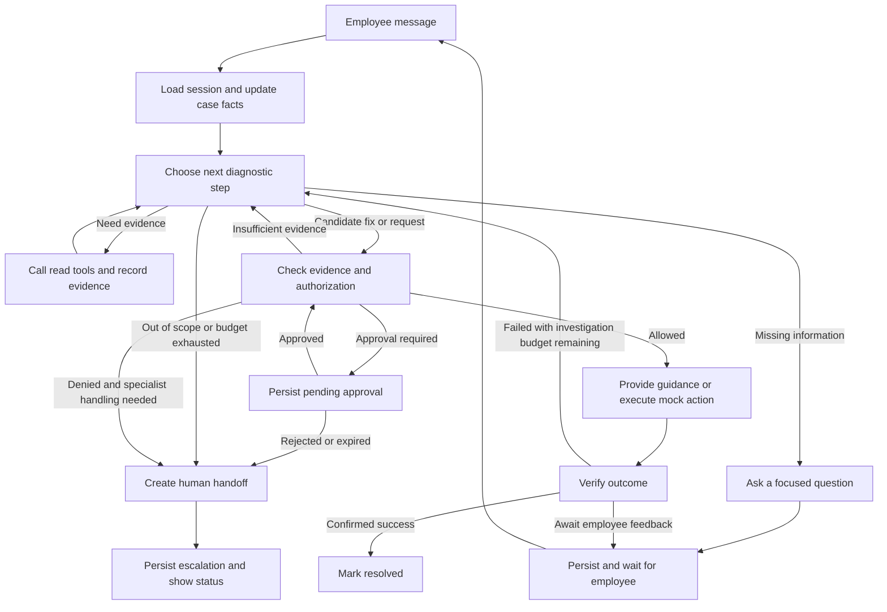
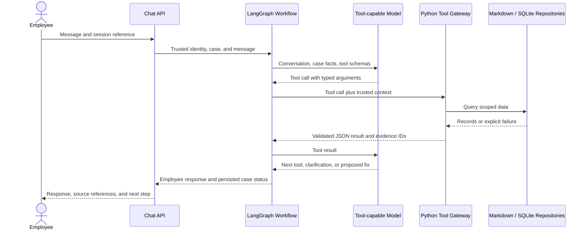

# IT Helpdesk Agent: Design References and Application Architecture

Date: October 12, 2026

Status: The local workflow, model integration, policy/approval, mock executor/verifier, human handoff, API/UI and evaluation runner are implemented. See [implementation milestones](docs/IMPLEMENTATION_PLAN.md), [progress](docs/PROGRESS.md), [evaluation evidence](docs/EVALUATION.md), and [repository ownership](docs/REPOSITORY_STRUCTURE.md) for validated behavior and limitations.

## 1. Product Goal and Scope

Build an employee-facing conversational IT support agent that investigates issues, guides or performs authorized fixes, verifies the outcome, and escalates with sufficient context for a human specialist to continue.

The primary user is an employee seeking help. Routine requests should be handled through conversation without requiring the employee to fill out a ticket form. An internal support case can track progress; a human-facing escalation record is created when human intervention is necessary.

The MVP will support:

- Account and login troubleshooting.
- VPN and connectivity troubleshooting.
- Application access requests, including requests requiring approval.
- One cross-system incident scenario to demonstrate investigation and escalation.

Use realistic synthetic knowledge articles, service status and change records, employee directory records, structured authorization policies, and a small historical-resolution archive. Section 9 defines their local mock formats and agent I/O; advanced historical retrieval remains an optional extension.

## 2. Lessons from Existing Projects

The references below were reviewed through documentation and selected source files. The projects were not installed or executed. Performance, resolution-rate, and production-readiness claims were not independently verified. Links point to evolving branches.

| Reference | Design to adopt | Adaptation required for this application |
|---|---|---|
| [Enterprise Access Portal](https://github.com/M-Elsaied/enterprise-access-portal) | Separate identity, training, policy, and request-processing tools; query structured facts before processing access requests. | Bind identity to trusted server-side session context. Enforce authorization at the execution boundary rather than relying on agent instructions or policy lookup alone. |
| [HolmesGPT](https://github.com/HolmesGPT/holmesgpt) | Iterative tool use across live data sources; extensible toolsets; explicit tool results and approval handling. | Add employee-facing clarification, account/access policies, outcome verification, and a human helpdesk handoff. |
| [OpenSRE — Tracer-Cloud](https://github.com/Tracer-Cloud/opensre) | Fixed investigation stages with a dynamic evidence-gathering loop; duplicate-call handling, loop budgets, context limits, and partial results on failure. | Keep the runtime small. Treat investigation stopping rules and action authorization as separate controls. |
| [NeuraDesk](https://github.com/Subh24ai/neuradesk) | Typed case state and separate intake, knowledge, action, and escalation responsibilities. | Check evidence and policy before executing actions. Verify outcomes before marking cases resolved. The README declares MIT, but an independent LICENSE file was not obtained during this review; confirm permission before reusing code. |
| [HelixDesk AI](https://github.com/Vkartik-3/HelixDesk-AI) | Ask the employee whether the proposed fix worked; provide an escalation path. | Preserve the full investigation context in the handoff and support continued diagnosis after a failed fix. |
| [AegisDesk](https://github.com/SarthakShrivastav-a/AegisDesk) | Merge facts across turns, apply explicit policies, and produce structured handoff information. | Add actual investigation tools and verification. Capturing details must not be treated as resolving the issue. |

Specific source findings that inform the architecture:

- NeuraDesk checks low-confidence escalation after its action node. This application will place the decision gate before sensitive execution. See [graph.py](https://github.com/Subh24ai/neuradesk/blob/main/agents/graph.py) and [action_node.py](https://github.com/Subh24ai/neuradesk/blob/main/agents/action_node.py).
- HelixDesk's UI triggers escalation after negative feedback and primarily passes the original issue and a ticket ID to its notification function. This application will include evidence, attempted fixes, results, and open questions. See [app.py](https://github.com/Vkartik-3/HelixDesk-AI/blob/main/app.py).
- AegisDesk's response node can label a case automatically resolved after collecting entities, without a demonstrated repair or verification step. This application will distinguish information capture, guidance, and verified resolution. See [nodes.py](https://github.com/SarthakShrivastav-a/AegisDesk/blob/main/app/graphs/workflow/nodes.py).
- OpenSRE separates host-controlled stages from an evidence-gathering agent loop. Adopt that separation without importing the whole platform. See [investigation architecture](https://github.com/Tracer-Cloud/opensre/blob/main/docs/investigation-pipeline-architecture.md).

The publicly visible [6rzan helpdesk repository](https://github.com/6rzan/ai-helpdesk-agent) is excluded from code-reuse candidates because its [license](https://github.com/6rzan/ai-helpdesk-agent/blob/main/LICENSE) reserves all rights. Public source visibility does not establish permission to reuse it.

## 3. Architecture Decision

Use Python and LangGraph for a single employee-facing diagnostic agent inside an explicit stateful workflow. Use Pydantic for tool contracts and structured outputs, SQLite for local persistence, and a thin chat interface backed by FastAPI.

The model chooses clarifying questions, investigation tools, and candidate diagnoses. Application code controls identity, authorization, execution, budgets, lifecycle transitions, and escalation records.

Workflow nodes are functions with clear responsibilities; they do not each require a separate autonomous agent. Multiple specialist agents, MCP servers, vector databases, and hosted tracing are optional extensions rather than MVP dependencies.

## 4. Major Application Modules

| Module | Responsibilities | Main interfaces and artifacts |
|---|---|---|
| **1. Employee Experience and API** | Accept chat messages, show progress and evidence references, collect clarification and fix feedback, and expose session and case endpoints. Derive employee identity from the session; use an explicit demo identity selector locally. | Chat UI; `send_message`, `get_case`, `submit_feedback`. |
| **2. Conversation and Workflow Orchestration** | Update case facts, identify missing information, select the next investigation step, route to guidance, action, approval, verification, or escalation, and enforce investigation budgets. | LangGraph state graph; typed next-step decisions; per-turn workflow execution. |
| **3. Evidence and Tool Gateway** | Provide KB search, service status/change lookup, employee directory lookup, and optional historical-resolution search. Validate arguments and normalize results, failures, source IDs, and timestamps. | Typed read tools; data adapters; `EvidenceRecord` and `ToolResult`. |
| **4. Policy and Authorization** | Decide whether a proposed action is allowed, denied, or requires approval. Check actor, target, environment, operation, and evidence prerequisites. Manage approval identity, scope, expiry, and rejection. | `authorize_action`; `PolicyDecision`; `ApprovalRecord`. |
| **5. Resolution and Verification** | Turn documented procedures into guidance, execute approved mock actions, and verify the business outcome. Record unsuccessful attempts and return to investigation when appropriate. | `execute_action`, `verify_outcome`; `ActionRecord`; `VerificationResult`. |
| **6. Human Escalation and Handoff** | Select the appropriate support group, create a durable escalation record, and preserve the investigation context. Show an honest handoff status to the employee. | `create_handoff`; `HandoffPackage`; local specialist queue. |
| **7. State, Persistence, and Audit** | Store conversations, case state, workflow checkpoints, evidence, approvals, actions, and handoffs. Support restart recovery, identity isolation, and action deduplication. | SQLite repositories; persistent LangGraph checkpointer; attributed audit events. |
| **8. Evaluation and Observability** | Test complete conversations and decision boundaries; trace model/tool calls, state transitions, failures, latency, and usage. Redact sensitive content from logs. | Scenario suite; trace events; evaluation report and runtime metrics. |

### Module Boundaries

- The UI cannot grant approval authority or supply a trusted employee identity through free-text chat.
- The workflow can propose an action but cannot execute it directly. Execution must pass through policy authorization and the action executor.
- Tool adapters return data and explicit errors. They do not decide that a case is resolved.
- The policy module uses deterministic rules for authorization. Model confidence is a diagnostic signal, not permission to act.
- The verification module owns the transition to `resolved`.
- A stored handoff is distinct from human acknowledgement. Do not tell the employee a specialist has accepted the case until that event is recorded.

## 5. Workflow



Re-check authorization when an approval is received because the case, target, or policy may have changed. Approval must be attached to a specific action and cannot be reused for unrelated requests.

## 6. Shared Case State and Contracts

Keep business state separate from the transcript. A case should contain:

- `case_id`, `session_id`, and trusted `employee_id`.
- Messages, issue category, symptoms, impact, urgency, and confirmed facts.
- Missing information and pending employee questions.
- Evidence records with source identifier, retrieval time, source time when available, and relevant facts.
- Candidate hypotheses with supporting evidence and unresolved contradictions; no private chain-of-thought storage is required.
- Attempted fixes and their observed outcomes.
- Proposed action, authorization decision, and approval reference.
- Tool failures, investigation steps, and remaining budget.
- Verification result, lifecycle status, and handoff reference.

Core contracts:

| Contract | Required information |
|---|---|
| `ToolResult` | Success/error status, data, source, timestamp, and error category; missing data is not a healthy result. |
| `PolicyDecision` | Allow/deny/approval-required result, rule IDs, reason, action scope, and required approver role. |
| `ActionRecord` | Actor, operation, target, authorization reference, idempotency key, execution status, and result. |
| `VerificationResult` | Success/failure/unknown result, verification method, and supporting observation. |
| `HandoffPackage` | Employee and impact, issue summary, evidence, attempted fixes and outcomes, unresolved questions, escalation reason, and suggested next step. |

Use lifecycle statuses such as `investigating`, `awaiting_employee`, `awaiting_approval`, `awaiting_verification`, `resolved`, and `escalated`. Supplying an answer, preparing an action, creating a ticket, or receiving HTTP 200 does not alone justify `resolved`.

## 7. Reliability and Safety Rules

- Apply timeouts and bounded retries. Retry state-changing operations only when idempotency or reconciliation makes repetition safe.
- Cache duplicate read calls within an investigation when their freshness requirements permit it. Refresh status data when circumstances change.
- Stop repeated investigation without new evidence and escalate with partial findings rather than inventing a diagnosis.
- Keep employee-supplied statements, retrieved instructions, tool observations, and application policy distinct.
- Require documented procedures and relevant evidence for fixes. Conflicting or stale sources trigger clarification, additional investigation, or escalation.
- Enforce identity and policy at every sensitive tool boundary, including password resets and access provisioning.
- Preserve failed attempts across turns so the employee is not repeatedly asked to perform the same unsuccessful step.
- Bound model calls, tool calls, elapsed investigation time, and context size through configuration.

## 8. Evaluation and MVP Acceptance

Build scenario conversations with expected decisions and outcomes, including:

1. A routine account issue resolved after clarification and confirmation.
2. A VPN issue where a known service outage changes the recommended response.
3. A production-access request that remains blocked until an authorized approval is recorded.
4. A vague problem that prompts focused questions instead of premature escalation.
5. Conflicting KB and status data that does not produce a fabricated fix.
6. A tool timeout that preserves partial evidence and produces a useful handoff.
7. A failed fix that continues investigation without repeating the same instructions.
8. An unauthorized or injected request that cannot bypass the action gate.
9. A restart during approval wait that preserves the case and pending decision.
10. A retried action request that does not execute the same side effect twice.

Evaluate resolution correctness, escalation appropriateness, evidence grounding, approval enforcement, handoff completeness, and conversation continuity. Report latency, tool/model call counts, and token usage alongside outcome metrics. Keep full conversation evaluation separate from retrieval-quality tests.

The first implementation should prioritize these behaviors over voice, broad integrations, dashboards, or multi-agent orchestration. Real SSO, Slack/Teams, ServiceNow, PostgreSQL, and advanced historical-resolution retrieval can follow once the local workflow is demonstrably reliable.

## 9. Local Demo: Mock Data and Agent I/O

### 9.1 Design Decision

The assignment asks for realistic synthetic data from at least two or three sources. The demo will provide small versions of all five suggested sources to cover diagnosis, access approval, and escalation without external IT systems.

Use Markdown for documents, JSON for versioned seed fixtures and rules, and SQLite for operational state. Run everything in one local backend process. The agent calls typed Python functions; these functions access local repositories. FastAPI handles employee messages and human review, not separate mock services for each data source. MCP is unnecessary for the first demo.

The mock boundary is the backend adapter. Diagnosis and tool selection still use a real tool-capable language model in the primary demo. Mock data does not mean prewritten agent answers or a conversation-to-answer lookup table. An optional fake model can support isolated tests, but those results must be reported separately from live-model evaluations. Local backend execution does not imply offline model inference.

### 9.2 Data Sources and Storage

| Assignment source | Local mock format | Suggested initial content | Agent access and mutation rules |
|---|---|---|---|
| **Knowledge base** | Markdown articles with a JSON metadata index. | 12–15 guides for Okta, VPN, Salesforce, Snowflake, Grafana, and incident escalation. Include prerequisites, applicability, approved steps, and verification instructions. | `search_knowledge` returns short excerpts and source IDs; `get_runbook` returns a selected procedure. Read-only during a case. |
| **System status** | JSON fixtures imported into SQLite tables for services, incidents, changes, account states, and device observations. | Healthy/degraded/outage states, office/region impact, maintenance records, VPN diagnostics, and Jenkins/Tableau observations. | `get_service_status`, `get_recent_changes`, and `get_diagnostic_snapshot` read current runtime rows. Only controlled mock actions or demo administration update them. |
| **User directory** | JSON employee/device/access fixtures imported into SQLite. | 6–8 employees with departments, locations, managers, assigned devices, roles, and existing grants. | `get_employee_context` reads the session-bound employee. An authorized executor can add an access grant; the model cannot edit directory rows. |
| **Resolution history** | JSON case archive imported into SQLite; simple filtered lexical search. | 8–10 resolved cases with symptoms, environment, cause, attempted actions, verification evidence, and timestamps. Include similar cases with different causes. | `search_resolution_history` returns relevant previous cases. Historical similarity is a hypothesis source, not authorization or proof of the current cause. |
| **Policy / rules** | Versioned JSON rules validated at startup and evaluated by deterministic Python code. | Rules for identity checks, self-service guidance, account actions, production access approval, security escalation, and missing-policy refusal. | `check_action_policy` explains a proposed action's decision. The executor independently re-evaluates policy before every mutation. No agent write access. |

Persist messages, cases, approvals, actions, evidence references, handoffs, and audit events in the application SQLite database. Use a separate SQLite checkpoint file for LangGraph execution state to keep checkpoint internals separate from business tables.

### 9.3 Proposed Data Layout

```text
data/
  knowledge/
    index.json
    okta_account_locked.md
    vpn_disconnects.md
    salesforce_regional_latency.md
    snowflake_access_request.md
    grafana_access_request.md
    pipeline_after_maintenance.md
  fixtures/
    employees.json
    devices.json
    access_grants.json
    services.json
    incidents.json
    changes.json
    account_states.json
    diagnostic_snapshots.json
    resolution_history.json
  policies/
    action_rules.json
  scenarios/
    baseline.json
    vpn_regional_outage.json
    production_access.json
    pipeline_maintenance.json
    conflicting_evidence.json
    tool_timeout.json
var/
  helpdesk.sqlite
  checkpoints.sqlite
```

The source fixtures, policies, knowledge articles, and scenario definitions are now created under `data/`. The actual layout also includes `resources.json`, `vpn_stale_profile.json`, and nine historical cases. Isolated runtime databases are created under `var/runs/<run-id>/helpdesk.sqlite`; checkpoint files will be added when the workflow is implemented. Keep seed data immutable and version-controlled; ignore generated runtime databases in Git. Each scenario defines fixture overrides, a fixed demo clock, and optional fault injection. Select the scenario outside the agent's context. Do not expose expected outcomes or scenario labels to the model. Create a fresh run directory for evaluation isolation rather than sharing mutable databases across scenarios. See [data setup instructions](data/README.md).

### 9.4 Minimum Record Schemas

| Record | Required fields |
|---|---|
| KB metadata | `article_id`, `title`, `service_id`, `tags`, `version`, `updated_at`, `applicability`, `path`. |
| Service observation | `service_id`, `health`, `region`, `affected_locations`, `incident_ids`, `observed_at`. |
| Change record | `change_id`, `service_ids`, `environment`, `started_at`, `ended_at`, `summary`, `status`. |
| Employee | `employee_id`, `department`, `location`, `manager_id`, `device_ids`, `account_status`, `roles`. |
| Access grant | `employee_id`, `resource_id`, `environment`, `role`, `status`, `granted_at`, `approval_id`. |
| Historical case | `history_id`, `symptoms`, `service_ids`, `environment`, `root_cause`, `actions`, `verified_outcome`, `resolved_at`. |
| Policy rule | `rule_id`, `version`, `operation`, `resource_scope`, `conditions`, `decision`, `approver_role`, `verification_requirements`. |

Use shared identifiers across files: an employee's device references a real fixture device; status, changes, runbooks, and history refer to the same service IDs. Establish a fixed demo clock, for example `2026-10-12T10:00:00+08:00`, and align maintenance/outage timestamps with it. Resolve phrases such as "last Friday" relative to this clock. Evaluation uses the fixed clock; interactive runs may use an explicitly configured live clock.

An example service-status fixture:

```json
{
  "service_id": "vpn",
  "health": "degraded",
  "region": "us-central",
  "affected_locations": ["Chicago"],
  "incident_ids": ["INC-DEMO-003"],
  "observed_at": "2026-10-12T09:55:00+08:00"
}
```

The agent should combine this observation with employee context and symptoms before concluding that the incident affects the employee. A matching service name alone is insufficient.

### 9.5 Read-Tool Contracts

Register a small tool catalog with the model. Use Pydantic argument/result schemas and inject a trusted `ToolContext` from the backend. Context contains `employee_id`, `case_id`, session permissions, repositories, and the clock; these are not model-generated identity arguments.

| Tool | Model-supplied input | Output |
|---|---|---|
| `get_employee_context` | No identity argument. | Relevant department, location, equipment, account state, and current grants for the session employee. |
| `search_knowledge` | `query`, optional `service_id`, bounded `limit`. | Ranked article IDs, excerpts, applicability, versions, and source timestamps. |
| `get_runbook` | `article_id`. | Documented steps, prerequisites, action identifiers, and verification criteria. |
| `get_service_status` | `service_id`, optional `region`. | Health, affected scope, incident details, and observation time; explicit unknown when no record exists. |
| `get_recent_changes` | `service_ids`, `since`, optional `environment`. | Relevant change records with timestamps and affected systems. |
| `get_diagnostic_snapshot` | `service_id`, optional `device_id`. | Mock account/device/build observations. Validate that the employee is allowed to inspect the requested target. |
| `search_resolution_history` | `query`, optional `service_id` and `environment`, bounded `limit`. | Previous cases, differences in context, actions, and verified outcomes. |
| `check_action_policy` | `operation`, `resource_id`, `environment`, proposed parameters. | Allow/deny/approval-required decision, rule version, prerequisites, and reason. No execution. |

For the small KB, start with deterministic lexical ranking over titles, tags, and document text. Search history using lexical ranking plus service/environment filters. Return a few relevant excerpts rather than all documents. Embeddings can be added if retrieval evaluations reveal a material gap; a vector database is not a prerequisite.

Normalize tool output into a JSON envelope:

```json
{
  "tool_call_id": "CALL-017",
  "status": "success",
  "data": {
    "service_id": "vpn",
    "health": "degraded",
    "affected_locations": ["Chicago"],
    "incident_ids": ["INC-DEMO-003"]
  },
  "sources": [
    {
      "source_id": "status:vpn:us-central",
      "source_type": "system_status",
      "version": "fixture-v1",
      "observed_at": "2026-10-12T09:55:00+08:00"
    }
  ],
  "retrieved_at": "2026-10-12T10:00:00+08:00",
  "error": null
}
```

Use `success`, `not_found`, `denied`, and `error` as distinct statuses. Errors include a machine-readable code, retryability, and a safe message. A timeout or absent status record must never become "service healthy". The gateway validates tool results, applies size limits, assigns evidence IDs, and records tool events before giving the result back to the model.

### 9.6 Write I/O and Controlled Mock Actions

Separate proposal, approval, execution, and verification:

1. The model submits `propose_action(operation, resource_id, environment, parameters, evidence_ids)`.
2. The backend validates the operation against an allowlist, binds the target to trusted context, and evaluates policy. It persists a proposal; proposing does not mutate account or access state.
3. If approval is required, persist an approval request and return `awaiting_approval`. An employee confirmation is not a manager/IT approval.
4. A separate local reviewer interface records approve/reject with a server-configured reviewer identity. The agent has no tool for granting itself approval.
5. The workflow calls the executor with the stored proposal ID. The executor reloads the proposal, checks authorization and approval scope/expiry, and applies the mock mutation transactionally.
6. A deterministic verifier reads the resulting state and returns success/failure/unknown. Employee-guided repairs additionally require employee feedback; a positive backend observation alone may not prove the user's symptom is gone.

Suggested executable operations are intentionally limited:

| Mock operation | Runtime effect | Verification |
|---|---|---|
| `unlock_demo_account` | Change an authorized employee's mock account from `locked` to `active`. | Re-read account state; request login feedback from the employee. |
| `refresh_demo_vpn_profile` | Update the assigned device's simulated VPN profile revision. | Read diagnostic snapshot; verify whether disconnections persist. A service outage should remain unresolved by a client refresh. |
| `grant_demo_access` | Insert a scoped access grant after the required policy/approval checks. | Query the grant and mock resource-access check; distinguish each requested resource and role. |
| `create_handoff` | Store a handoff and a local specialist-queue entry. | Confirm a durable handoff ID; specialist acknowledgement remains a separate event. |

Do not simulate password reset by printing a temporary password in chat. Account unlock is sufficient to demonstrate controlled account remediation. If password reset is added later, model a reset-request reference and a separate delivery channel.

Keep actions, audit events, and domain mutations in the same application-database transaction where practical. Store a unique idempotency key and action result so a replay returns the existing result. On restart, reconcile checkpoint state against committed action records before attempting execution again; the application and checkpoint databases are not one atomic transaction.

Simulated action behavior must depend on the current fixture state and operation, not on the expected answer. For example, refreshing a VPN profile fixes a stale-profile condition but cannot remove a regional outage. Record the observation actually returned even when it contradicts the hypothesis.

### 9.7 End-to-End I/O



The workflow repeats tool calls as needed within its budget. Ordinary clarification ends the current turn with saved state. Approval can pause execution with a durable checkpoint. Successful action execution is followed by verification rather than immediate resolution.

Proposed local API routes:

- `POST /demo/sessions`: select a fixture employee and obtain a backend-bound session. This is explicitly demo identity selection, not production authentication.
- `POST /cases`: create an internal case for that session.
- `POST /cases/{case_id}/messages`: process a conversational turn.
- `POST /cases/{case_id}/feedback`: report whether a suggested fix worked.
- `GET /cases/{case_id}`: view permitted case status, evidence references, and outstanding questions.
- `GET /review/approvals` and `POST /review/approvals/{approval_id}/decision`: local reviewer-only approval I/O.
- `GET /review/handoffs` and `POST /review/handoffs/{handoff_id}/acknowledge`: local specialist-queue I/O.

Scenario reset and fault configuration belong to a CLI or test fixture loader, outside the agent tool catalog. Reviewer routes require a separate demo reviewer session. Bind roles on the backend; a chat claim such as "I am the manager" cannot change permissions.

### 9.8 Demonstration Scenarios and Data Coverage

| Scenario | Sources combined | Expected behavior to evaluate |
|---|---|---|
| Locked Okta account | Directory/account state + runbook + policy. | Clarify relevant symptoms, authorize mock unlock, verify account state, and await login confirmation. |
| VPN disconnects | Employee/device context + diagnostics + service status + runbook/history. | Distinguish a stale profile from an outage; avoid repeating an ineffective client fix. |
| Snowflake PROD and Grafana access | Existing grants + department + separate resource policies + approval records. | Evaluate each resource separately, keep PROD access pending required approval, and verify any grant. |
| Jenkins timeouts after maintenance | Change history + service/build observations + runbook + historical cases. | Correlate timestamps without treating correlation as proof; escalate with evidence when production changes exceed authority. |
| Conflicting data or tool timeout | Source timestamps + fixture contradictions or injected errors. | Preserve uncertainty, retry within bounds, and provide a contextual handoff when evidence remains insufficient. |

Start implementation with fixture validation and read tools, then connect the conversational workflow, add one controlled action and its verifier, and finally implement approvals and escalation. Add data incrementally through the same adapters so module contracts remain stable when mocks are later replaced by real integrations.
