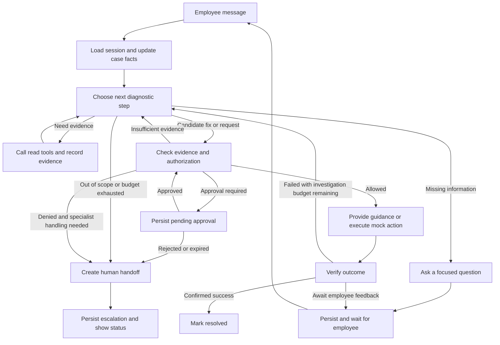
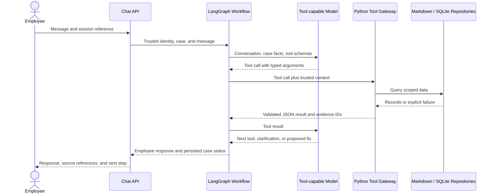

# IT Helpdesk Agent: Design References and Application Architecture

Date: October 12, 2026 (condensed October 14, 2026)

Status: workflow, model integration, policy/approval, mock executor/verifier, human handoff, API/UI, and evaluation runner are implemented. See [progress](docs/PROGRESS.md), [evaluation evidence](docs/EVALUATION.md), and [repository ownership](docs/REPOSITORY_STRUCTURE.md) for validated behavior and limitations.

## 1. Product Goal and Scope

An employee-facing conversational IT support agent that investigates issues, guides or performs authorized fixes, verifies the outcome, and escalates with enough context for a human specialist to continue. Routine requests are handled through conversation without a ticket form; an internal case tracks progress; an escalation record is created when human intervention is necessary.

MVP scope: account/login troubleshooting, VPN/connectivity troubleshooting, application access requests (including approval-gated ones), and one cross-system incident scenario.

## 2. Lessons from Existing Projects

References were reviewed through documentation and selected source files, not installed or executed; their performance claims were not verified.

| Reference | Design adopted | Adaptation for this application |
|---|---|---|
| [Enterprise Access Portal](https://github.com/M-Elsaied/enterprise-access-portal) | Separate identity, policy, and request-processing tools; query structured facts before access requests. | Bind identity to trusted server-side session context; enforce authorization at the execution boundary. |
| [HolmesGPT](https://github.com/HolmesGPT/holmesgpt) | Iterative tool use across live sources; explicit tool results and approval handling. | Add employee-facing clarification, access policies, outcome verification, and helpdesk handoff. |
| [OpenSRE — Tracer-Cloud](https://github.com/Tracer-Cloud/opensre) | Fixed investigation stages with a dynamic evidence loop; duplicate-call handling, budgets, partial results on failure. | Keep the runtime small; keep stopping rules and action authorization as separate controls. |
| [NeuraDesk](https://github.com/Subh24ai/neuradesk) | Typed case state; separate intake/knowledge/action/escalation responsibilities. | Check evidence and policy before execution; verify outcomes before `resolved`. It escalates *after* its action node — this application gates *before* sensitive execution. |
| [HelixDesk AI](https://github.com/Vkartik-3/HelixDesk-AI) | Ask the employee whether the fix worked; provide an escalation path. | Its handoff passes little more than the issue and a ticket ID; this application preserves evidence, attempts, results, and open questions. |
| [AegisDesk](https://github.com/SarthakShrivastav-a/AegisDesk) | Merge facts across turns; explicit policies; structured handoff. | It can label a case resolved after merely collecting entities; this application distinguishes capture, guidance, and verified resolution. |

The publicly visible [6rzan helpdesk repository](https://github.com/6rzan/ai-helpdesk-agent) is excluded from code reuse because its license reserves all rights.

## 3. Architecture Decision

Python + LangGraph for a single employee-facing diagnostic agent inside an explicit stateful workflow; Pydantic for contracts; SQLite for persistence; a thin FastAPI chat interface. The model chooses clarifying questions, investigation tools, and candidate diagnoses; application code controls identity, authorization, execution, budgets, lifecycle transitions, and escalation records. Multiple specialist agents, MCP servers, vector databases, and hosted tracing are optional extensions, not MVP dependencies.

## 4. Major Application Modules

| Module | Responsibilities |
|---|---|
| **Employee experience and API** | Chat messages, progress and evidence references, feedback; employee identity derived from the session (explicit demo selector locally). |
| **Conversation and workflow orchestration** | Update case facts, select next investigation step, route to guidance/action/approval/verification/escalation, enforce budgets. LangGraph state graph. |
| **Evidence and tool gateway** | KB search, status/change lookup, directory lookup, history search; validated arguments; normalized results with source IDs and timestamps. |
| **Policy and authorization** | Allow/deny/approval-required per actor, target, environment, operation, and evidence; approval identity, scope, expiry, rejection. |
| **Resolution and verification** | Guidance from documented procedures, approved mock actions, outcome verification; failed attempts return to investigation. |
| **Human escalation and handoff** | Support-group routing, durable escalation record, preserved context, honest handoff status. |
| **State, persistence, and audit** | Conversations, cases, checkpoints, evidence, approvals, actions, handoffs; restart recovery, identity isolation, action deduplication. |
| **Evaluation and observability** | Scenario suite, redacted traces of model/tool calls, latency and usage. |

Module boundaries: the UI cannot grant approval or supply trusted identity through chat text; the workflow proposes actions but cannot execute them; tool adapters return data, not resolution decisions; model confidence is a diagnostic signal, never permission; only the verification module transitions to `resolved`; a stored handoff is distinct from human acknowledgement.

## 5. Workflow



Authorization is re-checked when an approval arrives because case, target, or policy may have changed; approval is bound to a specific action and cannot be reused.

## 6. Shared Case State and Contracts

Business state is kept separate from the transcript. A case contains: `case_id`/`session_id`/trusted `employee_id`; messages, category, symptoms, impact, confirmed facts; missing information and pending questions; evidence records with source and retrieval/source times; candidate hypotheses with supporting evidence and contradictions (no chain-of-thought storage); attempted fixes and outcomes; proposed action, authorization decision, approval reference; tool failures, steps, remaining budget; verification result, lifecycle status, handoff reference.

| Contract | Required information |
|---|---|
| `ToolResult` | Success/error status, data, source, timestamp, error category; missing data is not a healthy result. |
| `PolicyDecision` | Allow/deny/approval-required, rule IDs, reason, action scope, required approver role. |
| `ActionRecord` | Actor, operation, target, authorization reference, idempotency key, execution status, result. |
| `VerificationResult` | Success/failure/unknown, verification method, supporting observation. |
| `HandoffPackage` | Employee and impact, issue summary, evidence, attempted fixes and outcomes, unresolved questions, escalation reason, suggested next step. |

Lifecycle statuses: `investigating`, `awaiting_employee`, `awaiting_approval`, `awaiting_verification`, `resolved`, `escalated`. Supplying an answer, preparing an action, creating a ticket, or receiving HTTP 200 never alone justifies `resolved`.

## 7. Reliability and Safety Rules

- Timeouts and bounded retries; state-changing retries only with idempotency or reconciliation.
- Cache duplicate reads within freshness limits; refresh status data when circumstances change.
- Stop investigation that produces no new evidence; escalate with partial findings rather than inventing a diagnosis.
- Keep employee statements, retrieved instructions, tool observations, and application policy distinct.
- Fixes require documented procedures and relevant evidence; conflicting/stale sources trigger clarification, more investigation, or escalation.
- Enforce identity and policy at every sensitive tool boundary.
- Preserve failed attempts across turns so the employee is not asked to repeat unsuccessful steps.
- Bound model calls, tool calls, elapsed time, and context size through configuration.

## 8. Evaluation and MVP Acceptance

Scenario conversations with expected decisions and outcomes: routine account fix after clarification; outage changing the VPN recommendation; production access blocked until approval; vague problem prompting focused questions; conflicting data producing no fabricated fix; tool timeout preserving partial evidence in a useful handoff; failed fix continuing investigation; injected/unauthorized request failing at the action gate; restart during approval wait preserving the case; retried action not duplicating side effects.

Evaluate resolution correctness, escalation appropriateness, evidence grounding, approval enforcement, handoff completeness, and conversation continuity; report latency, tool/model call counts, and token usage. These behaviors take priority over voice, broad integrations, dashboards, or multi-agent orchestration.

## 9. Local Demo: Mock Data and Agent I/O

### 9.1 Design Decision

The assignment asks for realistic synthetic data from at least two or three sources; the demo provides small versions of all five suggested sources plus diagnostic snapshots. Markdown for documents, JSON for versioned fixtures/rules, SQLite for operational state, one local backend process. The agent calls typed Python functions over local repositories; there are no separate mock services and no MCP.

The mock boundary is the backend adapter. Diagnosis and tool selection still use a real tool-capable model; mock data does not mean prewritten answers. An optional fake model supports isolated tests, reported separately from live-model evaluations.

### 9.2 Data Sources and Storage

| Assignment source | Local mock format | Agent access and mutation rules |
|---|---|---|
| **Knowledge base** | 14 Markdown articles with a JSON index: guides for Okta, VPN, Salesforce, Snowflake, Grafana, escalation, with prerequisites, applicability, approved steps, verification. | `search_knowledge` returns excerpts and source IDs; `get_runbook` returns a selected procedure. Read-only during a case. |
| **System status** | JSON fixtures imported into SQLite: services, incidents, changes, account states, device observations. | `get_service_status`, `get_recent_changes`, `get_diagnostic_snapshot` read current runtime rows. Only controlled mock actions or demo administration mutate them. |
| **User directory** | JSON employee/device/access fixtures imported into SQLite: 8 employees with departments, locations, managers, devices, roles, grants. | `get_employee_context` reads the session-bound employee. Only the authorized executor adds grants; the model cannot edit directory rows. |
| **Resolution history** | 9 JSON case records imported into SQLite; filtered lexical search. | `search_resolution_history` returns comparable cases. Similarity is a hypothesis source, not authorization or proof. |
| **Policy / rules** | 7 versioned JSON rules validated at startup, evaluated by deterministic Python. | `check_action_policy` explains a decision. The executor independently re-evaluates policy before every mutation. No agent write access. |

Messages, cases, approvals, actions, evidence references, handoffs, and audit events persist in the application SQLite database; LangGraph execution state uses a separate checkpoint SQLite file.

### 9.3 Data Layout and Schemas

```text
data/
  knowledge/   index.json + 14 articles (okta, vpn, salesforce, snowflake, grafana, pipeline, ...)
  fixtures/    employees, devices, access_grants, services, incidents, changes,
               account_states, diagnostic_snapshots, resolution_history, resources
  policies/    action_rules.json
  scenarios/   baseline, account_lockout, vpn_stale_profile, vpn_regional_outage,
               production_access, pipeline_maintenance, conflicting_evidence,
               tool_timeout, mixed_issues
var/runs/<run-id>/   helpdesk.sqlite + checkpoints.sqlite (generated, Git-ignored)
```

Source fixtures, policies, articles, and scenarios are immutable and version-controlled under `data/`; each scenario defines fixture overrides, a fixed demo clock, and optional fault injection, selected outside the agent's context. Expected outcomes and scenario labels are never exposed to the model. Each evaluation run gets a fresh directory. See [data setup instructions](data/README.md).

Minimum record schemas: KB metadata (`article_id`, `title`, `service_id`, `tags`, `version`, `updated_at`, `applicability`, `path`); service observation (`service_id`, `health`, `region`, `affected_locations`, `incident_ids`, `observed_at`); change (`change_id`, `service_ids`, `environment`, `started_at`, `ended_at`, `summary`, `status`); employee (`employee_id`, `department`, `location`, `manager_id`, `device_ids`, `account_status`, `roles`); access grant (`employee_id`, `resource_id`, `environment`, `role`, `status`, `granted_at`, `approval_id`); historical case (`history_id`, `symptoms`, `service_ids`, `environment`, `root_cause`, `actions`, `verified_outcome`, `resolved_at`); policy rule (`rule_id`, `version`, `operation`, `resource_scope`, `conditions`, `decision`, `approver_role`, `verification_requirements`).

Identifiers are shared across files: an employee's device references a real fixture device; status, changes, runbooks, and history share service IDs. The demo clock is fixed at `2026-10-12T10:00:00+08:00`; phrases such as "last Friday" resolve against it. The agent must combine an observation with employee context before concluding an incident affects that employee — a matching service name alone is insufficient.

### 9.4 Read-Tool Contracts

Tools use Pydantic argument/result schemas and a trusted backend-injected `ToolContext` (`employee_id`, `case_id`, session permissions, repositories, clock) — never model-generated identity arguments.

| Tool | Model-supplied input | Output |
|---|---|---|
| `get_employee_context` | No identity argument. | Department, location, equipment, account state, current grants for the session employee. |
| `search_knowledge` | `query`, optional `service_id`, bounded `limit`. | Ranked article IDs, excerpts, applicability, versions, source timestamps. |
| `get_runbook` | `article_id`. | Documented steps, prerequisites, action identifiers, verification criteria. |
| `get_service_status` | `service_id`, optional `region`. | Health, affected scope, incident details, observation time; explicit unknown when no record exists. |
| `get_recent_changes` | `service_ids`, `since`, optional `environment`. | Relevant change records with timestamps and affected systems. |
| `get_diagnostic_snapshot` | `service_id`, optional `device_id`. | Mock account/device/build observations; target scope validated. |
| `search_resolution_history` | `query`, optional `service_id`/`environment`, bounded `limit`. | Previous cases, context differences, actions, verified outcomes. |
| `check_action_policy` | `operation`, `resource_id`, `environment`, proposed parameters. | Allow/deny/approval-required, rule version, prerequisites, reason. No execution. |

Retrieval is deterministic lexical ranking over titles, tags, and text; embeddings are an option only if retrieval evaluations reveal a material gap. Tool output is normalized into a JSON envelope with `tool_call_id`, `status` (`success` / `not_found` / `denied` / `error`), `data`, `sources` (source ID, type, version, observation time), `retrieved_at`, and a machine-readable `error` with retryability. A timeout or absent record must never become "service healthy". The gateway validates results, applies size limits, assigns evidence IDs, and records tool events before returning to the model.

### 9.5 Write I/O and Controlled Mock Actions

Proposal, approval, execution, and verification are separate:

1. The model submits `propose_action(operation, resource_id, environment, parameters, evidence_ids)`; the backend validates against an allowlist, binds the target to trusted context, evaluates policy, and persists a proposal. Proposing never mutates state.
2. If approval is required, a durable approval request returns `awaiting_approval`. Employee confirmation is not manager/IT approval.
3. A separate local reviewer interface records approve/reject with a server-configured reviewer identity; the agent has no tool for granting itself approval.
4. The executor reloads the stored proposal, rechecks authorization and approval scope/expiry, and applies the mock mutation transactionally.
5. A deterministic verifier reads the resulting state. Employee-guided repairs additionally require employee feedback; a positive backend observation alone may not prove the symptom is gone.

Executable operations are intentionally limited:

| Mock operation | Runtime effect | Verification |
|---|---|---|
| `unlock_demo_account` | Authorized employee's mock account `locked` → `active`. | Re-read account state; request login feedback. |
| `refresh_demo_vpn_profile` | Update the assigned device's simulated VPN profile revision. | Read diagnostic snapshot; a service outage must remain unresolved by a client refresh. |
| `grant_demo_access` | Insert a scoped access grant after policy/approval checks. | Query the grant and mock access check; distinguish each resource and role. |
| `create_handoff` | Store a handoff and specialist-queue entry. | Confirm a durable handoff ID; acknowledgement remains a separate event. |

Simulated behavior depends on current fixture state and the operation, never on the expected answer; observations are recorded even when they contradict the hypothesis. Actions, audit events, and domain mutations share a transaction where practical; a unique idempotency key makes replays return the existing result. On restart, checkpoint state is reconciled against committed action records before any re-execution.

### 9.6 End-to-End I/O



The workflow repeats tool calls within budget; clarification ends the turn with saved state; approval pauses execution on a durable checkpoint; successful execution is followed by verification, not immediate resolution.

Local API routes: `POST /demo/sessions` (explicit demo identity selection, not production authentication), `POST /cases`, `POST /cases/{case_id}/messages`, `POST /cases/{case_id}/feedback`, `GET /cases/{case_id}`, `GET /review/approvals` + `POST /review/approvals/{approval_id}/decision`, `GET /review/handoffs` + `POST /review/handoffs/{handoff_id}/acknowledge`. Reviewer routes require a separate demo reviewer session; roles are backend-bound, so a chat claim of "I am the manager" cannot change permissions.

### 9.7 Demonstration Scenarios

| Scenario | Sources combined | Expected behavior |
|---|---|---|
| Locked Okta account | Directory/account state + runbook + policy. | Clarify, authorize mock unlock, verify, await login confirmation. |
| VPN disconnects | Employee/device context + diagnostics + status + runbook/history. | Distinguish stale profile from outage; avoid repeating an ineffective client fix. |
| Snowflake PROD and Grafana access | Grants + department + per-resource policies + approvals. | Evaluate each resource separately; PROD waits for approval; verify any grant. |
| Jenkins timeouts after maintenance | Change history + build/service observations + runbook + history. | Correlate timestamps without treating correlation as proof; escalate when production changes exceed authority. |
| Conflicting data or tool timeout | Source timestamps + fixture contradictions or injected errors. | Preserve uncertainty, bounded retry, contextual handoff when evidence stays insufficient. |
