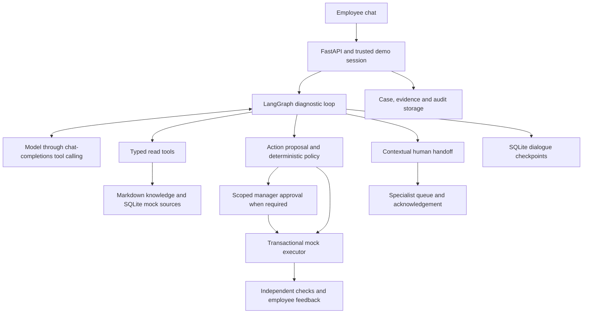

# 面向员工的 IT 服务台智能体 / Employee-Facing IT Helpdesk Agent

本地运行的对话式 IT 支持智能体：员工用自然语言描述问题，智能体调查后执行经授权的模拟修复、给出有文档依据的指导，或在需要人工时保留完整调查上下文进行交接。所有员工、IT 系统与数据均为合成，操作只影响本地 SQLite 数据库。

A local conversational IT support agent. An employee describes a problem in chat; the agent investigates, performs an authorized simulated fix or documented guidance, and hands off with full investigation context when a human is needed. The model is real; all employees, IT systems, and data are synthetic, and actions touch only an isolated local SQLite database. 

## 问题与选题原因 / Problem and why

员工遇到高频 IT 问题——账号锁定、VPN 断连、应用权限、跨系统故障——往往要在工单队列里等待。主要用户是员工；经理在限定范围的访问请求需要审批时进入流程，服务台专员在智能体无法安全解决时进入流程。成功标准：常规问题以"有文档依据的修复 + 独立核验到的系统状态 + 员工明确确认"闭环；无法解决时，"成功"是一次有用且诚实的交接，不要求员工重复调查。

Employees with frequent IT problems — account lockouts, VPN drops, application access, cross-system incidents — often wait in a ticket queue. The primary user is the employee; a manager enters when a scoped access request needs approval, and a helpdesk specialist when the agent cannot safely resolve the issue. Success means a routine issue closed with a documented fix, an independently observed system state, and explicit employee confirmation; for an unresolved issue, success is a useful, honest handoff that never asks the employee to repeat the investigation. 

## 为什么采用智能体方案 / Why an agentic approach

同一症状（如"VPN 反复断连"）可能源于设备配置过期，也可能是区域性故障——FAQ 检索不检查当前状态就无法区分；规则引擎适合授权判断，却做不了对话式诊断；简单聊天机器人则无法调用工具核实事实。此外员工会补充新信息、工具可能失败、访问请求可能要先审批才能继续。因此由模型选择下一个诊断工具或追问、比对多源证据、随轮次调整策略；身份、策略、执行、核验与案例状态则由普通代码确定性控制。这种分工既支持灵活调查，又保证系统变更始终处于明确授权之内。

The same symptom ("VPN keeps disconnecting") can come from a stale device profile or a regional outage — FAQ search cannot tell which applies without checking current state; a rule engine suits authorization but not conversational diagnosis; a plain chatbot cannot call tools to verify facts. Employees also add information mid-conversation, tools fail, and access requests may need approval before work continues. So the model chooses the next diagnostic tool or question, compares evidence across sources, and adapts over turns, while ordinary code deterministically controls identity, policy, execution, verification, and case state. This division supports flexible investigation while keeping system changes within explicit authority.

## 架构与设计决策 / Architecture and design decisions



| 组件 Component | 职责与决策 Responsibility and decision |
|---|---|
| `workflow/`, `models/` | 单一 LangGraph 诊断循环交替模型/工具步骤。此规模下单一智能体职责最清晰。<br>One LangGraph diagnostic loop alternates model and tool step. One agent keeps ownership clear at this scope. |
| `tools/`, `adapters/`, `knowledge/` | 七个类型化读取工具返回事实、来源 ID、时间戳与显式 成功/缺失/拒绝/错误；小型语料用词法检索，可检查且够用（检索为纯关键词检索，没有加模糊检索）。<br>Seven typed read tools return facts, source IDs, timestamps, and explicit success/missing/denied/error outcomes; lexical retrieval is inspectable and sufficient for the small corpus. |
| `policy/` | 默认拒绝的确定性规则从可信后端事实推导权限；模型无法通过参数伪造身份、授权确认或审批。<br>Default-deny deterministic rules derive authority from trusted backend facts; the model cannot forge identity, consent, or approval through parameters. |
| `resolution/` | 事务内重校验授权、幂等执行、员工确认关闭前独立核验当前状态。<br>Execution rechecks authorization inside a transaction, records idempotent effects, and verifies current state before employee confirmation can close the case. |
| `escalation/` | 交接包持久化问题与补充、证据、已尝试修复、错误、未决问题与下一步建议；专员可签收队列案例。<br>Handoff packages persist the issue and updates, evidence, attempted fixes, errors, open questions, and a next step; specialists can acknowledge a queued case. |
| `domain/`, `storage/` | Pydantic 契约；SQLite 业务库与 LangGraph 检查点库分离，无需额外数据库服务。<br>Pydantic contracts; separate SQLite databases for business records and LangGraph checkpoints, so no extra database service is needed. |

核心取舍：模型负责调查与表达，代码负责权限与副作用；读取先持久化为证据再返回；写入只通过执行器修改本次运行的 SQLite；持久化的提案回执与幂等键可在不重放变更的情况下对账中断的工具调用。

Core tradeoff: the model investigates and explains while code owns authority and side effects; reads persist as evidence before being returned; writes change only the run's SQLite through the executor; durable proposal receipts and idempotency keys reconcile interrupted tool calls without replaying mutations.

## 解决与升级的边界 / Resolution and escalation boundary

| 问题 Issue | 智能体权限 Agent's authority | 人工边界 Human boundary |
|---|---|---|
| 锁定的 Okta 账号<br>Locked Okta account | 具备证据、可信会话身份、策略授权与员工明确确认后解锁模拟账号；核验状态并请员工确认登录。<br>Unlock the simulated account with evidence, trusted session identity, policy authorization, and explicit consent; verify state and request login confirmation. | 身份/MFA 恢复、安全疑虑、修复无效。<br>Identity/MFA recovery, security concerns, ineffective fix. |
| 过期的 VPN 配置文件<br>Stale VPN profile | 确认并完成当前故障排查后刷新指定受管设备的模拟配置文件；核验并请员工反馈。<br>Refresh the assigned managed device's simulated profile after consent and a current outage check; verify and request feedback. | 存在适用的区域故障、证据冲突、问题持续。<br>Applicable regional outage, conflicting evidence, persistent failure. |
| 内部 Grafana 访问<br>Internal Grafana access | 通过策略检查后，为数据工程员工授予模拟内部查看者权限。<br>Grant a Data Engineering employee simulated internal viewer access after policy checks. | 不支持的角色、部门或范围。<br>Unsupported role, department, or scope. |
| Snowflake 生产库访问<br>Snowflake production access | 准备只读权限提案；等待通讯录中直属经理的限定范围审批后再执行并核验。<br>Prepare a reader-access proposal; wait for the directory manager's scoped approval before executing and verifying. | 审批被拒/过期、写权限等被拒范围。审批与专员升级是两条不同路径。<br>Rejected/expired approval or denied scope. Approval is distinct from specialist escalation. |
| Salesforce 变慢<br>Salesforce slowness | 查服务健康、检索操作手册与历史，提供有依据的指导或转交。<br>Query health, retrieve the runbook and history, offer supported guidance or handoff. | 大范围/持续服务问题。专属场景与实时评估尚待补充。<br>Widespread/persistent problems. A dedicated scenario and live evaluation are still missing. |
| Jenkins/Snowflake/Tableau 故障<br>Jenkins/Snowflake/Tableau incident | 收集维护、构建、服务健康与下游报表证据；区分"假设"与"已确认原因"。<br>Collect maintenance, build, health, and downstream-report evidence; distinguish hypothesis from confirmed cause. | 生产网络/凭据修复转交 SRE；系统没有生产修复类工具。<br>Production network/credential repair goes to SRE; there is no production-repair tool. |

默认 fail closed：操作不受支持或缺少必要证据时后端拒绝；预算耗尽、重复无效调用、工具/模型故障或证据不足同样触发交接。交接包含初始问题、员工补充、证据及来源时间、已尝试修复、错误、未决问题与升级原因，按上下文路由到 IT 服务台、网络、SRE 或安全团队。`queued` 与 `acknowledged` 是两个不同状态，都不代表问题已修复。

The backend fails closed when an action is unsupported or lacks required evidence; exhausted budgets, repeated unproductive calls, tool/model failures, or insufficient evidence also produce a handoff. A handoff includes the initial problem, employee updates, evidence and source times, attempted fixes, errors, open questions, and the escalation reason, routed to IT helpdesk, network, SRE, or security by case context. `queued` and `acknowledged` are distinct states; neither means the problem is repaired.

## 模拟数据源及原因 / Simulated data sources and why

覆盖说明建议的全部五类数据源，另加诊断快照；员工身份与故障条件独立建模（同类问题可发生在多名员工身上，一人也可同时遇到多种问题），基础数据保持健康，由场景模板注入可复现的故障。

All five suggested source categories are covered, plus diagnostic snapshots. Identities and fault conditions are modeled independently (the same problem can hit several employees, and one employee can have several problems); healthy fixtures receive reproducible scenario conditions.

| 数据源 Source | 本地形式 Local form | 用途与原因 Agent use and reason |
|---|---|---|
| 知识库 Knowledge base | `data/knowledge/` 14 篇带索引的 Markdown<br>14 indexed Markdown articles | `search_knowledge` / `get_runbook` 获取适用流程与升级边界。<br>Obtain applicable procedures and escalation boundaries. |
| 系统状态与变更 System status and changes | 七个服务的 JSON 夹具（故障、变更窗口）灌入 SQLite<br>JSON fixtures for seven services seeded into SQLite | `get_service_status` / `get_recent_changes` 区分设备问题与服务中断，关联维护与症状。<br>Distinguish device issues from outages; correlate maintenance with symptoms. |
| 用户目录 User directory | 八名员工及其设备、账号状态、资源与授权<br>Eight employees with devices, account states, resources, grants | `get_employee_context` 使用会话绑定身份；部门与范围影响诊断和权限。<br>Session-bound identity; department and scope affect diagnosis and permissions. |
| 解决历史 Resolution history | 九条合成的历史解决记录<br>Nine synthetic past resolutions | `search_resolution_history` 检索可类比案例；相似性只提示假设，不证明当前原因。<br>Comparable cases suggest hypotheses, not proof of the current cause. |
| 策略/规则 Policy/rules | `data/policies/action_rules.json` 七条精确匹配规则<br>Seven exact-match rules | 后端评估 允许/需审批/拒绝；模型不能修改规则。<br>Backend evaluation decides allow/approval-required/deny; the model cannot edit rules. |
| 诊断数据 Diagnostics | 账号、设备、Jenkins 构建与 Tableau 刷新快照<br>Account, device, Jenkins build, Tableau refresh snapshots | `get_diagnostic_snapshot` 提供当前观测，印证或反驳状态与历史。<br>Current observations to corroborate or contradict status and history. |

智能体通过类型化工具访问数据，不直接读写文件/数据库；场景覆盖与故障注入由操作者设置，预期结果与场景标签不会出现在模型指令中。详见[数据说明](data/README.md)。

The agent accesses data through typed tools, never directly through files or the database; scenario overrides and faults are set by the operator, and expected outcomes or scenario labels never appear in model instructions. See the [data guide](data/README.md).

## 如何运行 / How to run

在仓库根目录的 PowerShell 中运行。**Python 3.13 是经过测试的运行时**。真实对话需要一个支持工具调用的 chat-completions 端点；测试与数据校验不需要模型凭据。

Run from the repository root in PowerShell. **Python 3.13 is the tested runtime**. Real conversations need a tool-capable chat-completions endpoint; tests and data validation need no model credentials.

```powershell
python -m venv .venv          # 若 .venv 已存在可跳过 / skip if .venv exists
.\.venv\Scripts\python.exe -m pip install -r requirements.lock
.\.venv\Scripts\python.exe -m pip install -e . --no-deps
.\.venv\Scripts\python.exe -m pip check

# 仅当 .env 不存在时创建，然后本地编辑三个占位符（BASE_URL / API_KEY / MODEL_NAME）
# Create .env only if missing, then edit the three placeholders locally
if (-not (Test-Path -LiteralPath '.env')) { Copy-Item '.env.example' '.env' }

.\.venv\Scripts\python.exe scripts/demo_data.py validate
$demoRunId = 'demo-' + (Get-Date -Format 'yyyyMMdd-HHmmss')
.\.venv\Scripts\python.exe scripts/demo_data.py seed --scenario mixed_issues --random-seed 42 --run-id $demoRunId
$env:HELPDESK_RUN_DIR = "var/runs/$demoRunId"
.\.venv\Scripts\python.exe scripts/check_model.py
.\.venv\Scripts\python.exe -m uvicorn helpdesk.api.main:app --host 127.0.0.1 --port 8000 --no-access-log
```

打开 <http://127.0.0.1:8000>。seed 输出会列出哪些员工有锁定账号或过期 VPN 配置（两组可重叠）；应用权限申请相互独立；数据工程员工可查看共享的 Jenkins/Tableau 故障；经理审批使用请求人的真实直属经理；EMP-007 为 IT 专员、EMP-008 处理安全交接。身份选择器只是演示模拟，不是生产认证。演示时钟固定为 `2026-10-12T10:00:00+08:00`。切换场景：停服务器、灌新运行、改 `HELPDESK_RUN_DIR`、重启。可选配置见 [.env.example](.env.example)；默认每轮最多 8 次模型调用、16 次工具调用。

Open <http://127.0.0.1:8000>. The seed output lists which employees have locked accounts or stale VPN profiles (the groups overlap); access requests are independent; Data Engineering employees can inspect the shared Jenkins/Tableau incident; approvals go to the requester's actual directory manager; EMP-007 is an IT specialist and EMP-008 handles security handoffs. The identity selector is demo simulation, not production authentication. The demo clock is fixed at `2026-10-12T10:00:00+08:00`. To switch scenarios: stop the server, seed a fresh run, point `HELPDESK_RUN_DIR` at it, restart. Optional settings are in [.env.example](.env.example); defaults bound each turn to 8 model calls and 16 tool calls.

## 如何评估 / Evaluation

```powershell
.\.venv\Scripts\python.exe -m pytest -q                 # 确定性测试 / deterministic tests
.\.venv\Scripts\python.exe scripts/run_evaluation.py --list   # 预览 7 类问题 × 2 员工 = 14 用例 / preview the matrix
.\.venv\Scripts\python.exe scripts/run_evaluation.py          # 实时评估，消耗服务商 token / live run, spends provider tokens
```

**确定性测试**使用脚本化模型与隔离数据库，覆盖身份隔离、来源追溯、策略优先级、限定范围审批、事务幂等、核验、交接上下文与 API 边界：2026-10-14 **121 个测试全部通过**。**实时评估**用真实模型、独立灌入的数据库与模拟的员工/经理反馈；评分检查持久化的证据、执行效果、核验与交接记录，而不是接受助手自称的"成功"。

**Deterministic tests** use scripted models and isolated databases, covering identity isolation, provenance, policy precedence, scoped approvals, transactional idempotency, verification, handoff context, and API boundaries: **121 passed on 2026-10-14**. **Live evaluations** use the real model, independently seeded databases, and simulated employee/manager feedback; scoring examines persisted evidence, effects, verification, and handoff records rather than the assistant's own claim of success.

2026-10-14 新版 14 用例实时矩阵已运行：**14 中 13 通过**（含两个账号解锁用例；1 个证据冲突用例轮次用尽时仍等待员工输入，未通过交接检查，失败已保留在报告中）。下表是上一版夹具各场景最近一次试验的历史结果（报告文件本地已不保留，非一次基准测试，也不代表生产成功率）：

The version-2 14-case live matrix ran on 2026-10-14: **13 of 14 passed** (including both account-unlock cases; one conflicting-evidence case ended awaiting employee input and failed its handoff check — retained in the report). The table below is version-1 history: the most recent saved trial per scenario (report files no longer kept locally; separate runs, not one benchmark, not a production success rate):

| 场景 Scenario | 结果 Result | 秒数 Seconds |
|---|---|---:|
| 账号解锁 Account unlock | 失败；服务商在工具调用前不可用（更早一次试验曾成功解决）<br>Failed: provider unavailable before tools (an earlier trial resolved) | 22.67 |
| VPN 配置过期 Stale VPN profile | 通过；模拟刷新 + 核验 + 员工确认<br>Passed: simulated refresh, verification, confirmation | 32.33 |
| 区域 VPN 故障 Regional VPN outage | 通过；带上下文交接，无系统变更<br>Passed: contextual handoff, no mutation | 89.20 |
| Snowflake/Grafana 访问 Access | 通过；两个资源均覆盖，生产权限审批已记录<br>Passed: both resources covered, PROD approval recorded | 58.08 |
| 维护后管道故障 Pipeline after maintenance | 通过；变更/构建/报表证据齐全，转交 SRE<br>Passed: change/build/report evidence, SRE handoff | 31.46 |
| VPN 证据冲突 Conflicting evidence | 结果检查通过；后续模型失败触发降级交接<br>Outcome checks passed; later model failure caused fallback | 61.27 |
| 工具超时 Tool timeout | 结果检查通过；工具错误保留在交接中<br>Outcome checks passed; tool errors preserved in handoff | 59.65 |

失败案例：早期过宽的操作 schema 导致资源/参数选错——收紧 schema 修复了这类契约性失败，后端策略则始终拒绝非法操作；服务商超时与不可用仍是独立的失败模式。管道场景复测消耗 3 次模型调用、13 次工具调用、19,957 输入 / 1,300 输出 token。

Failure cases: an early over-broad action schema caused wrong resource/parameter choices — stricter schemas fixed those contract failures while backend policy kept rejecting invalid actions; provider timeouts and unavailability remain a separate failure mode. The pipeline retest consumed 3 model calls, 13 tool calls, and 19,957 input / 1,300 output tokens.

## 假设与取舍 / Assumptions and tradeoffs

- 夹具身份选择器与合成经理/专员角色使本地演示可行；这不是生产级访问控制。<br>Fixture identity selection and synthetic manager/specialist roles enable a local demo; this is not production access control.
- 词法检索 + SQLite 中的 JSON 记录便于检查小语料；更大语料需要检索质量评估、索引与新鲜度控制。<br>Lexical retrieval and JSON records in SQLite keep the small corpus inspectable; larger corpora would need retrieval-quality evaluation, indexing, and freshness controls.
- 固定时钟与隔离运行保证可复现，但无法模拟持续变化的企业服务。<br>A fixed clock and isolated runs make scenarios reproducible but cannot mimic continuously changing enterprise services.
- 自助执行仅限三种模拟操作；指导可覆盖更多有文档的问题，但不支持的修复必须交人。<br>Self-service execution is limited to three simulated operations; guidance covers more documented issues, but unsupported repairs require a human.
- 同步串行轮次 + 轮询进度简化了本地状态安全；无逐 token 流式、无摘要压缩、无分布式协调；token/调用预算只限制工作量，不强制执行金额预算或案例截止时限。<br>Synchronous serialized turns with polled progress simplify local state safety; no token streaming, summarization, or distributed coordination; token/call budgets bound work, not monetary cost or a whole-case deadline.

## 有更多时间会改进什么 / Improvements with more time

1. 把 Salesforce/芝加哥变慢做成专属故障场景并补实时评估（操作手册、状态与历史已存在，缺端到端证据）。<br>Add the Salesforce/Chicago slowdown as a dedicated scenario with live evaluation (runbook, status, and history exist; end-to-end evidence is missing).
2. 针对含糊/超范围请求、缺失操作手册、员工拒绝授权与对抗性来源文本，补真实模型的多轮试验。<br>Add real-model multi-turn trials for vague/out-of-scope requests, missing runbooks, declined consent, and adversarial source text.
3. 服务商可靠性：重复试验、记录失败分类与时延分布、评估不重放操作的重试策略。<br>Provider reliability: repeated trials, failure categories, latency distributions, and retry policies that never replay mutations.
4. 语义级评估：澄清质量、引用有效性、不确定性表达与交接准确性（目前笼统的失败交接也能通过结构性升级检查）。<br>Semantic evaluation: clarification quality, citation validity, uncertainty expression, and handoff accuracy (a generic failure handoff currently passes structural escalation checks).
5. 宣称"多数案例可解决"或"两分钟 SLA"前，先测量真实员工结果、响应时间与金钱成本。<br>Measure real employee outcomes, response time, and monetary cost before claiming majority resolution or a two-minute SLA.
6. 生产化方向：SSO 替代夹具身份、最小权限的目录/状态/IT 操作 API、Slack/Teams 入口、携带完整证据的 ServiceNow 交接、密钥管理与数据保留策略。<br>Production direction: SSO instead of fixture identities, least-privilege directory/status/IT-action APIs, Slack/Teams delivery, ServiceNow handoff with full evidence, secret management, and data retention.
