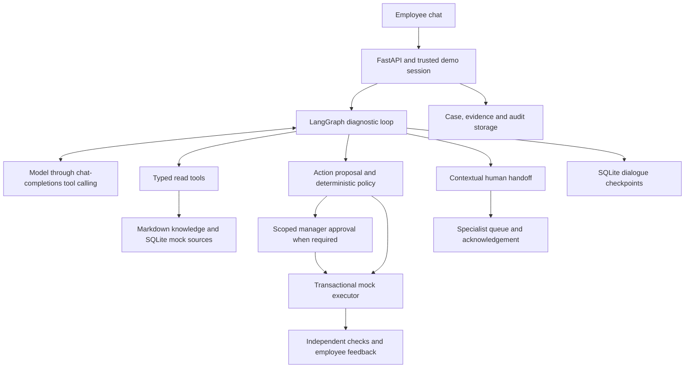

# Employee-Facing IT Helpdesk Agent

A local conversational IT support agent for employees who need help with account lockouts, VPN connectivity, application permissions, and incidents spanning several systems. Employees describe their problem in chat; the agent investigates, proposes an authorized fix or documented guidance, and preserves the investigation when human IT is needed.

The model is real; all employees, IT systems, policies, and procedures are synthetic. Actions affect only an isolated local database. This is the runnable demo for the [candidate instructions](agentic_ai_take_home_candidate_instructions_v20260421_01.html). The [requirement-by-requirement audit](docs/REQUIREMENTS_CHECKLIST.md) distinguishes implementation from validation and lists remaining gaps.

## Problem, user, and success criteria

The primary user is an employee with an IT problem. A helpdesk specialist enters the flow when the agent cannot safely resolve it; a manager enters when a scoped access request needs approval. Repetitive issues are a useful starting point because their diagnosis combines documented procedures with employee-specific state, service health, and authorization rules.

The interaction model is a browser chat backed by FastAPI. The employee does not fill out a ticket form: the application keeps an internal case record while the agent asks focused questions and selects tools. Consent and fix feedback use explicit controls. A separate reviewer panel simulates the manager or specialist's view.

A successful routine interaction ends with a documented fix, an independently observed simulated system outcome where an action ran, and explicit employee confirmation. A request involving several resources stays open until all recorded resources are covered. For guidance without an executable action, closure uses employee-confirmed documented guidance; this is weaker evidence than an independent system probe.

The product target is a routine resolution within two minutes without waiting in an initial ticket queue. Recorded synthetic trials demonstrate examples within that time; they exclude real employee response time and do not establish an SLA or that a majority of production issues can be resolved. For an unresolved issue, success means a useful, honest handoff without asking the employee to repeat the investigation.

## Why an agentic approach

A symptom such as repeated VPN disconnections can come from a stale device profile or a regional outage. A FAQ lookup cannot decide which applies without checking current state. An employee may add new information, a tool may fail, and an access request may need approval before work can continue.

The model chooses the next diagnostic tool or question, compares evidence from several sources, and adjusts the conversation across turns. Ordinary code controls identity, policy, execution, verification, and case state. A rule engine suits authorization; it does not replace conversational diagnosis. This division supports flexible investigation while keeping system changes within explicit authority.

## Architecture and design decisions



| Component | Responsibility and decision |
|---|---|
| `workflow/`, `models/` | One LangGraph diagnostic agent alternates model and tool steps. The provider adapter uses an OpenAI-compatible SDK interface; it does not require an OpenAI-hosted model. One agent keeps ownership clear for this scope. |
| `tools/`, `adapters/`, `knowledge/` | Seven validated read tools return facts, source IDs, timestamps, and explicit success/missing/denied/error outcomes. Lexical retrieval is inspectable and sufficient for the small corpus. |
| `policy/` | Default-deny rules derive authority from trusted backend facts. The model cannot set identity, consent, or approval through action parameters. |
| `resolution/` | Execution rechecks authorization inside a transaction, records idempotent effects, and verifies current state before employee confirmation can close the case. |
| `escalation/` | Handoff packages persist the employee's issue and updates, evidence, attempted fixes, errors, uncertainty recorded in the case, and a next step. Specialists can acknowledge a queued case. |
| `domain/`, `storage/`, `bootstrap/` | Pydantic contracts, owned sessions/cases, optimistic revisions, configuration, and a fixed demo clock. SQLite avoids a separate database service. |
| `observability/`, `evaluation/` | Audit events, redacted metadata traces, usage/latency, isolated live conversation trials, and scoring based on stored outcomes. |

Business records and LangGraph checkpoints use separate databases. Durable proposal receipts and action idempotency reconcile interrupted tool exchanges without replaying mutations. The local process serializes agent turns; distributed execution is outside the current design.

See the [detailed architecture and project comparisons](IT_HELPDESK_ARCHITECTURE.md), [repository structure](docs/REPOSITORY_STRUCTURE.md), and [implementation plan](docs/IMPLEMENTATION_PLAN.md).

## Resolution and escalation boundary

| Issue | Agent's authority | Human boundary |
|---|---|---|
| Locked Okta account | Unlock the employee's simulated account with applicable evidence, trusted session identity, policy authorization, and explicit consent. Verify account state and request login confirmation. | Identity/MFA recovery, security concerns, unsupported account problems, or an ineffective fix. |
| Stale VPN profile | Refresh the assigned managed device's simulated profile after consent and a current outage check. Verify device/profile state and request stability feedback. | Applicable regional outage, conflicting evidence, missing diagnostics, or persistent failure. |
| Internal Grafana access | Grant a Data Engineering employee simulated internal viewer access after consent and policy checks. | Unsupported role, department, or scope. |
| Snowflake production access | Prepare a reader-access proposal with business justification; wait for the employee's directory manager's scoped approval before executing and verifying. | Rejected/expired approval, writer access, or other denied scope. Approval is distinct from specialist escalation. |
| Salesforce slowness | Query health, retrieve its runbook and relevant history, and offer supported guidance or handoff. | Widespread/persistent service problems. A dedicated slowdown scenario and live evaluation are still missing. |
| Jenkins/Snowflake/Tableau incident | Collect maintenance, build, service-health and downstream-report evidence; distinguish a hypothesis from a confirmed cause. | Production network/credential repair goes to SRE. There is no production-repair execution tool. |

The backend fails closed when an action is unsupported or lacks required evidence. Investigation budgets, repeated unproductive calls, tool/model failures, or insufficient evidence can also produce a handoff. There is no arbitrary shell or device-command tool.

A handoff includes the initial problem, subsequent employee updates, available facts/impact, evidence and source times, attempted fixes, errors, recorded unresolved questions, and the reason for escalation. Routing selects IT helpdesk, network, SRE, or security from the case context. `queued` and `acknowledged` are distinct states; neither is a claim that the employee's problem was repaired.

## Simulated data and agent I/O

All five suggested source categories are represented, with an additional diagnostic source. Fixtures are deliberately small but include competing explanations and time-dependent evidence.

| Source | Local form | Agent use and reason |
|---|---|---|
| Knowledge base | 14 indexed Markdown articles in `data/knowledge/` | `search_knowledge` and `get_runbook` obtain applicable procedures and escalation boundaries. |
| System status and changes | JSON fixtures for seven services, incidents, and change windows, seeded into SQLite | `get_service_status` and `get_recent_changes` distinguish device issues from outages and correlate maintenance with symptoms. |
| User directory | Eight employees and assigned devices, account states, resources, and access grants | `get_employee_context` uses session-bound identity; employee scope and department affect diagnosis and permissions. |
| Resolution history | Nine synthetic past resolutions | `search_resolution_history` retrieves comparable cases. Similarity suggests hypotheses, not proof of the current cause. |
| Policy/rules | Seven exact-match rules in `data/policies/action_rules.json` | Backend evaluation determines allow, approval-required, or deny; the model cannot edit rules. |
| Diagnostics | Account, device, Jenkins build, and Tableau refresh snapshots | `get_diagnostic_snapshot` provides current observations to corroborate or contradict status and history. |

The agent accesses these through typed tools, not direct file/database access. Reads persist evidence before returning it. Authorized writes change only the run's SQLite records through the executor. Scenario overrides and fault settings are applied by the operator; expected outcomes and evaluation scenario labels are excluded from privileged model instructions. See the [data guide](data/README.md).

## Setup and local run

Run commands from the repository root in PowerShell. **Python 3.13 is the tested runtime** (3.13.5 locally); project metadata permits Python 3.11+, but other versions have not been verified. A tool-capable chat-completions endpoint and network access to that provider are needed for real conversations. Fixture validation and deterministic tests need no model credentials or external IT systems.

For a fresh environment, create a virtual environment and install the captured dependency versions. Skip creation if the project's `.venv` already exists.

```powershell
python -m venv .venv
.\.venv\Scripts\python.exe -m pip install -r requirements.lock
.\.venv\Scripts\python.exe -m pip install -e . --no-deps
.\.venv\Scripts\python.exe -m pip check
```

Direct dependencies are Pydantic, LangGraph and its SQLite checkpointer, the OpenAI-compatible SDK adapter, python-dotenv, FastAPI, and Uvicorn. pytest and HTTPX support tests. `pyproject.toml` declares these; `requirements.lock` captures the tested environment, including transitive dependencies. No vector database, Docker, frontend build process, or enterprise account is required. A clean-machine installation of the captured versions remains unverified.

Create `.env` from the template only if it does not already exist, then edit the placeholders locally:

```powershell
if (-not (Test-Path -LiteralPath '.env')) {
    Copy-Item -LiteralPath '.env.example' -Destination '.env'
}
```

```dotenv
HELPDESK_MODEL_BASE_URL=https://your-provider.example/v1
HELPDESK_MODEL_API_KEY=replace-locally
HELPDESK_MODEL_NAME=your-tool-capable-model
```

Environment variables override `.env`. The current defaults are a 60-second timeout per model request, eight model calls, 16 tool calls, and 48,000 context characters per employee turn; each response has an adapter limit of 1,800 output tokens. These are investigation limits, not an end-to-end latency guarantee. Optional settings are in [.env.example](.env.example). Credentials are kept out of model prompts and API output; `.env` and generated `var/` files are ignored by Git.

Validate the fixtures, create an independent baseline run, check model compatibility, and start the server:

```powershell
.\.venv\Scripts\python.exe scripts/demo_data.py validate
$demoRunId = 'interview-' + (Get-Date -Format 'yyyyMMdd-HHmmss')
.\.venv\Scripts\python.exe scripts/demo_data.py seed --scenario baseline --run-id $demoRunId
$env:HELPDESK_RUN_DIR = "var/runs/$demoRunId"
.\.venv\Scripts\python.exe scripts/check_model.py
.\.venv\Scripts\python.exe -m uvicorn helpdesk.api.main:app --host 127.0.0.1 --port 8000 --no-access-log
```

Open [the local chat](http://127.0.0.1:8000). Choose EMP-003 for account lockout or EMP-004 for stale VPN. For a combined Snowflake/Grafana request, use EMP-001, then EMP-005 in the separate approval panel. EMP-007 is an IT specialist who can inspect and acknowledge ordinary handoffs; EMP-008 handles security handoffs. These selectors simulate identity and roles; they are not production authentication.

The demo clock is fixed at `2026-10-12T10:00:00+08:00`. The API requires loopback clients and the same origin. To switch scenarios, stop the server, seed a fresh named run, set `HELPDESK_RUN_DIR` to it, and restart. Seeding refuses existing database files. If the model probe fails, check the endpoint/model's function-calling support and local configuration; diagnostic failures do not expose credentials.

## Evaluation: method, results, and failure cases

```powershell
# Deterministic tests: isolated databases and scripted models; no provider calls.
.\.venv\Scripts\python.exe -m pytest -q

# Live conversation evaluation: all seven configured scenarios; consumes provider tokens.
.\.venv\Scripts\python.exe scripts/run_evaluation.py

# A bounded retest of the cross-system incident only.
.\.venv\Scripts\python.exe scripts/run_evaluation.py --scenarios pipeline_maintenance --max-turns 5
```

The deterministic suite covers identity isolation, provenance, missing/conflicting observations, timeouts, state/restart continuity, policy precedence, scoped approvals, transactional idempotency, verification, handoff context, and API boundaries. **56 tests passed** in the requirement audit on 2026-10-12; data validation and `pip check` also passed in the current environment.

Live evaluations use actual model-selected tool calls and independent seeded databases, with simulated employee feedback and manager decisions. Scoring examines persisted evidence, effects, verification, and handoff records instead of accepting an assistant's claim of success.

| Scenario | Most recent saved trial | Seconds | Qualification |
|---|---|---:|---|
| Account unlock | Failed; escalated | 22.67 | Provider unavailable before tools; an earlier trial resolved successfully. |
| Stale VPN profile | Passed; resolved | 32.33 | Simulated profile refresh, verification, and confirmation. |
| Regional VPN outage | Passed; escalated | 89.20 | Contextual handoff; no system mutation. |
| Snowflake/Grafana access | Passed; resolved | 58.08 | Both resources covered; production approval recorded. |
| Pipeline after maintenance | Passed; escalated | 31.46 | Change, Jenkins build and Tableau evidence; queued for SRE. |
| Conflicting VPN evidence | Passed outcome checks; escalated | 61.27 | Partial evidence preserved; later model failure caused fallback. |
| Tool timeout | Passed outcome checks; escalated | 59.65 | Tool errors preserved; later model failure caused fallback. |

These are the latest saved trials from separate runs, not one benchmark or a production success rate. The pipeline retest used three model calls and 13 tool calls, consuming 19,957 input and 1,300 output tokens. Initial broad action schemas caused wrong resource/parameter choices; stricter tool schemas fixed those contract failures while backend policy continued to reject invalid actions. Provider timeouts and unavailable responses remain a separate failure mode.

Generated raw reports are local files in `var/evaluation/`; case evidence/audit events and dialogue checkpoints live in each `var/runs/eval-*` directory. They are ignored by Git. The submission's durable summary is [EVALUATION.md](docs/EVALUATION.md); rerun the commands to generate raw artifacts on another machine. Usage counts cover responses reporting token usage; failed-request billing and dollar cost are unknown without provider data.

## Assumptions and tradeoffs

- Synthetic directory identities and manager/specialist roles allow local demonstration. A local user can select any fixture identity; the demo is not a production access-control deployment.
- Lexical retrieval and JSON records in SQLite keep the small corpus easy to inspect. Larger corpora would need retrieval-quality evaluation, indexing, and stricter freshness/retention controls.
- The fixed clock and isolated runs make scenario comparisons reproducible. They do not reproduce continuously changing enterprise services or observed long-running VPN sessions.
- Self-service execution is limited to three simulated operation types. Guidance can cover a wider set of documented issues, but unsupported repairs require a human.
- Persistent dialogue retains investigation history until a budget is reached. There is no summarization/compaction strategy or distributed worker coordination.
- Synchronous, serialized turns simplify local state safety but provide neither streaming replies nor production concurrency. Token/call budgets bound work; they do not enforce a monetary budget or a whole-case deadline.

## Remaining gaps and improvements with more time

1. Add the HTML's Salesforce/Chicago slowdown as a dedicated incident scenario and live conversation evaluation. Its runbook, status record, and history already exist, but they do not establish end-to-end support for that example.
2. Add real-model multi-turn trials for vague/incomplete requests, missing runbooks, out-of-scope requests, declined consent, and adversarial source text. Existing scripted/backend tests establish selected boundaries, not the model's behavior on new interview inputs.
3. Complete browser interaction/visual QA and a clean installation rehearsal. API/static tests and JavaScript syntax checks passed; the integrated browser tool could not initialize because of the Windows sandbox helper error.
4. Improve provider reliability and repeat trials. Record failure categories, latency distributions, and recovery behavior without replaying actions; evaluate provider/model choices and explicit retry policies.
5. Strengthen evaluation beyond structural outcome checks: judge clarification quality, source relevance/citation validity, uncertainty, unsupported advice, and handoff accuracy. A generic failure handoff currently can pass an escalation check; that does not demonstrate a completed diagnosis.
6. Measure actual employee outcomes, response time, and monetary cost before claiming majority-case resolution or an under-two-minute SLA.

For production, replace fixture identity selection with SSO, connect least-privilege directory/status/IT action APIs, and deliver the conversation through Slack/Teams or an authenticated web interface. Forward escalations to a human service such as ServiceNow with the same evidence/attempt history. Add secret management, data retention and deletion, monitoring, rate limits, distributed state coordination, and reviewed production runbooks. These integrations are optional future design work for this take-home.

## Interview walkthrough and documentation

Use the [demo guide](docs/DEMO_GUIDE.md) for scenario prompts, employee/reviewer choices, and what to observe. Show one verified routine fix, the two-resource approval flow, and a cross-system handoff; inspect its queue acknowledgement and evidence. Also accept a fresh problem typed by the interviewer and show clarifying questions or the actual limitation rather than selecting a canned answer. The API accepts arbitrary problem text, but live handling of unplanned ambiguous problems has not yet been systematically validated. No recorded demo has been prepared.

Review the [evaluation successes and failures](docs/EVALUATION.md), [implementation progress](docs/PROGRESS.md), and [HTML requirement audit](docs/REQUIREMENTS_CHECKLIST.md) before presenting. The audit records which deliverables are complete, which behaviors have partial evidence, and which validation work remains.
