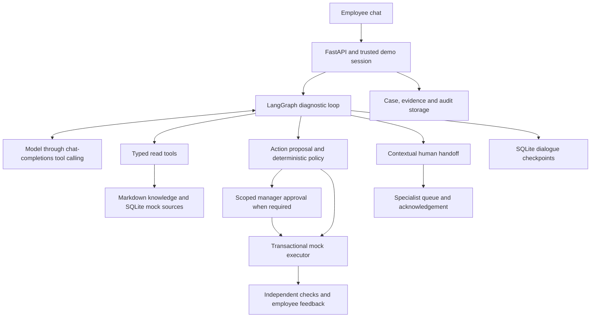

# 面向员工的 IT 服务台智能体 / Employee-Facing IT Helpdesk Agent

> 本 README 为中/英对照版本：每个段落先给出中文，随后是英文原文；代码块中的命令不做翻译。
> This README is bilingual: each paragraph gives the Chinese version first, followed by the original English. Commands in code blocks are not translated.

本项目是一个在本地运行的对话式 IT 支持智能体，服务对象是遇到账号锁定、VPN 连接、应用权限以及跨多个系统的故障等问题的员工。员工在聊天界面中描述问题；智能体进行调查，提出经授权的修复操作或有文档依据的指导，并在需要人工 IT 介入时完整保留调查记录。

A local conversational IT support agent for employees who need help with account lockouts, VPN connectivity, application permissions, and incidents spanning several systems. Employees describe their problem in chat; the agent investigates, proposes an authorized fix or documented guidance, and preserves the investigation when human IT is needed.

模型是真实的；所有员工、IT 系统、策略与流程均为合成数据。所有操作只影响一个隔离的本地数据库。本仓库是[候选人说明（candidate instructions）](agentic_ai_take_home_candidate_instructions_v20260421_01.html)对应的可运行演示。[逐条需求审计](docs/REQUIREMENTS_CHECKLIST.md)区分了"已实现"与"已验证"，并列出了遗留缺口。

The model is real; all employees, IT systems, policies, and procedures are synthetic. Actions affect only an isolated local database. This is the runnable demo for the [candidate instructions](agentic_ai_take_home_candidate_instructions_v20260421_01.html). The [requirement-by-requirement audit](docs/REQUIREMENTS_CHECKLIST.md) distinguishes implementation from validation and lists remaining gaps.

## 问题、用户与成功标准 / Problem, user, and success criteria

主要用户是遇到 IT 问题的员工。当智能体无法安全地解决问题时，服务台专员进入流程；当一个限定范围的访问请求需要审批时，经理进入流程。重复性问题是一个合适的切入点，因为其诊断需要结合文档化流程、员工自身状态、服务健康状况与授权规则。

The primary user is an employee with an IT problem. A helpdesk specialist enters the flow when the agent cannot safely resolve it; a manager enters when a scoped access request needs approval. Repetitive issues are a useful starting point because their diagnosis combines documented procedures with employee-specific state, service health, and authorization rules.

交互模型是由 FastAPI 支撑的浏览器聊天界面。员工不需要填写工单表单：应用内部维护一份案例（case）记录，由智能体提出有针对性的问题并选择工具。授权确认与修复反馈使用显式控件。另设一个独立的审核面板，模拟经理或专员的视角。

The interaction model is a browser chat backed by FastAPI. The employee does not fill out a ticket form: the application keeps an internal case record while the agent asks focused questions and selects tools. Consent and fix feedback use explicit controls. A separate reviewer panel simulates the manager or specialist's view.

在等待回复期间，调查面板会实时显示执行步骤。回答使用可点击的编号来源，而不是内部证据 ID。折叠的开发者检查器展示调用元数据与证据映射；服务端将已提交的 JSON 行事件写入 stderr 和当前运行目录下的滚动日志 `app.log`。员工/开发者视图边界、轮询行为与引用处理详见[交互设计文档](docs/INTERACTION_DESIGN.md)。

The investigation panel shows live execution steps while a reply is pending. Answers use clickable numbered sources instead of internal evidence IDs. A collapsed developer inspector shows call metadata and evidence mappings; the server writes committed JSON-line events to stderr and the active run's rotating `app.log`. See [interaction design](docs/INTERACTION_DESIGN.md) for the employee/developer boundary, polling behavior and citation handling.

一次成功的常规交互以以下结果收尾：有文档依据的修复；若执行了操作，则需有独立观测到的模拟系统结果；以及员工的明确确认。涉及多个资源的请求会保持打开状态，直到所有已记录的资源都被处理。对于没有可执行操作的纯指导类问题，以"员工确认过的、有文档依据的指导"作为关闭依据——这属于弱于独立系统探测的证据。

A successful routine interaction ends with a documented fix, an independently observed simulated system outcome where an action ran, and explicit employee confirmation. A request involving several resources stays open until all recorded resources are covered. For guidance without an executable action, closure uses employee-confirmed documented guidance; this is weaker evidence than an independent system probe.

产品目标是在两分钟内完成常规问题的解决，无需在初始工单队列中等待。已记录的合成试验展示了在该时间内完成的示例；这些试验不包含真实员工的响应时间，也不能确立 SLA，或证明生产环境中多数问题都可被解决。对于无法解决的问题，"成功"意味着一次有用且诚实的交接，且不要求员工重复调查过程。

The product target is a routine resolution within two minutes without waiting in an initial ticket queue. Recorded synthetic trials demonstrate examples within that time; they exclude real employee response time and do not establish an SLA or that a majority of production issues can be resolved. For an unresolved issue, success means a useful, honest handoff without asking the employee to repeat the investigation.

## 为什么采用智能体（Agentic）方案 / Why an agentic approach

例如"VPN 反复断连"这一症状，可能源于设备配置文件过期，也可能源于区域性故障。不检查当前状态，FAQ 检索无法判断属于哪种情况。员工可能补充新信息，工具可能失败，访问请求可能需要先审批才能继续处理。

A symptom such as repeated VPN disconnections can come from a stale device profile or a regional outage. A FAQ lookup cannot decide which applies without checking current state. An employee may add new information, a tool may fail, and an access request may need approval before work can continue.

由模型选择下一个诊断工具或问题、比对来自多个来源的证据，并在多轮对话中调整交流策略。身份、策略、执行、校验与案例状态则由普通代码控制。规则引擎适合授权判断，但无法替代对话式诊断。这种分工既支持灵活调查，又保证系统变更始终处于明确授权之内。

The model chooses the next diagnostic tool or question, compares evidence from several sources, and adjusts the conversation across turns. Ordinary code controls identity, policy, execution, verification, and case state. A rule engine suits authorization; it does not replace conversational diagnosis. This division supports flexible investigation while keeping system changes within explicit authority.

## 架构与设计决策 / Architecture and design decisions



| 组件 Component | 职责与决策 Responsibility and decision |
|---|---|
| `workflow/`, `models/` | 单个 LangGraph 诊断智能体交替执行模型步骤与工具步骤。服务商适配器使用 OpenAI 兼容的 SDK 接口，不要求模型托管在 OpenAI。在本范围内，单一智能体使职责归属清晰。<br>One LangGraph diagnostic agent alternates model and tool steps. The provider adapter uses an OpenAI-compatible SDK interface; it does not require an OpenAI-hosted model. One agent keeps ownership clear for this scope. |
| `tools/`, `adapters/`, `knowledge/` | 七个经过校验的读取工具返回事实、来源 ID、时间戳，以及明确的 成功/缺失/拒绝/错误 结果。词法检索对小型语料库而言便于检查且足够使用。<br>Seven validated read tools return facts, source IDs, timestamps, and explicit success/missing/denied/error outcomes. Lexical retrieval is inspectable and sufficient for the small corpus. |
| `policy/` | 默认拒绝的规则从可信的后端事实推导权限。模型无法通过操作参数设置身份、授权确认或审批结果。<br>Default-deny rules derive authority from trusted backend facts. The model cannot set identity, consent, or approval through action parameters. |
| `resolution/` | 执行时在事务内重新校验授权，记录幂等的执行效果，并在员工确认可关闭案例之前核验当前状态。<br>Execution rechecks authorization inside a transaction, records idempotent effects, and verifies current state before employee confirmation can close the case. |
| `escalation/` | 交接包持久化员工的问题与后续补充、证据、已尝试的修复、错误、案例中记录的不确定性，以及下一步建议。专员可以签收队列中的案例。<br>Handoff packages persist the employee's issue and updates, evidence, attempted fixes, errors, uncertainty recorded in the case, and a next step. Specialists can acknowledge a queued case. |
| `domain/`, `storage/`, `bootstrap/` | Pydantic 契约、归属明确的会话/案例、乐观版本控制、配置，以及固定的演示时钟。SQLite 避免了额外的数据库服务。<br>Pydantic contracts, owned sessions/cases, optimistic revisions, configuration, and a fixed demo clock. SQLite avoids a separate database service. |
| `observability/`, `evaluation/` | 审计事件、脱敏的元数据追踪、用量/时延统计、隔离的实时对话试验，以及基于已存储结果的评分。<br>Audit events, redacted metadata traces, usage/latency, isolated live conversation trials, and scoring based on stored outcomes. |

业务记录与 LangGraph 检查点使用独立的数据库。持久化的提案回执与操作幂等性可以在不重放变更的情况下，对中断的工具交互进行对账。本地进程串行化智能体的各轮次；分布式执行不在当前设计范围内。

Business records and LangGraph checkpoints use separate databases. Durable proposal receipts and action idempotency reconcile interrupted tool exchanges without replaying mutations. The local process serializes agent turns; distributed execution is outside the current design.

详见[详细架构与方案对比](IT_HELPDESK_ARCHITECTURE.md)、[仓库结构](docs/REPOSITORY_STRUCTURE.md)与[实现计划](docs/IMPLEMENTATION_PLAN.md)。

See the [detailed architecture and project comparisons](IT_HELPDESK_ARCHITECTURE.md), [repository structure](docs/REPOSITORY_STRUCTURE.md), and [implementation plan](docs/IMPLEMENTATION_PLAN.md).

## 解决与升级的边界 / Resolution and escalation boundary

| 问题 Issue | 智能体的权限 Agent's authority | 人工边界 Human boundary |
|---|---|---|
| 锁定的 Okta 账号<br>Locked Okta account | 在具备适用证据、可信会话身份、策略授权与员工明确确认的前提下，解锁员工的模拟账号。核验账号状态并请员工确认能否登录。<br>Unlock the employee's simulated account with applicable evidence, trusted session identity, policy authorization, and explicit consent. Verify account state and request login confirmation. | 身份/MFA 恢复、安全疑虑、不支持的账号问题，或修复无效。<br>Identity/MFA recovery, security concerns, unsupported account problems, or an ineffective fix. |
| 过期的 VPN 配置文件<br>Stale VPN profile | 在获得确认并完成当前故障排查后，刷新指定受管设备的模拟配置文件。核验设备/配置文件状态并请员工反馈稳定性。<br>Refresh the assigned managed device's simulated profile after consent and a current outage check. Verify device/profile state and request stability feedback. | 存在适用的区域性故障、证据冲突、缺少诊断信息，或问题持续存在。<br>Applicable regional outage, conflicting evidence, missing diagnostics, or persistent failure. |
| 内部 Grafana 访问<br>Internal Grafana access | 在获得确认并通过策略检查后，为数据工程团队的员工授予模拟的内部查看者权限。<br>Grant a Data Engineering employee simulated internal viewer access after consent and policy checks. | 不支持的角色、部门或范围。<br>Unsupported role, department, or scope. |
| Snowflake 生产库访问<br>Snowflake production access | 准备附带业务理由的只读权限提案；等待员工在通讯录中的直属经理在限定范围内审批通过后，再执行并核验。<br>Prepare a reader-access proposal with business justification; wait for the employee's directory manager's scoped approval before executing and verifying. | 审批被拒绝/过期、写入权限或其他被拒绝的范围。审批与专员升级是两条不同的路径。<br>Rejected/expired approval, writer access, or other denied scope. Approval is distinct from specialist escalation. |
| Salesforce 变慢<br>Salesforce slowness | 查询服务健康状况，检索其操作手册与相关历史记录，并提供有依据的指导或转交人工。<br>Query health, retrieve its runbook and relevant history, and offer supported guidance or handoff. | 大范围/持续性的服务问题。专门的变慢场景与实时评估尚待补充。<br>Widespread/persistent service problems. A dedicated slowdown scenario and live evaluation are still missing. |
| Jenkins/Snowflake/Tableau 故障<br>Jenkins/Snowflake/Tableau incident | 收集维护窗口、构建、服务健康与下游报表证据；区分"假设"与"已确认的原因"。<br>Collect maintenance, build, service-health and downstream-report evidence; distinguish a hypothesis from a confirmed cause. | 生产网络/凭据修复转交 SRE。系统没有生产环境修复类执行工具。<br>Production network/credential repair goes to SRE. There is no production-repair execution tool. |

当操作不受支持或缺少必要证据时，后端以"拒绝"为默认行为（fail closed）。调查预算耗尽、重复无效的调用、工具/模型故障或证据不足，同样会触发交接。系统没有任意 shell 或设备命令类工具。

The backend fails closed when an action is unsupported or lacks required evidence. Investigation budgets, repeated unproductive calls, tool/model failures, or insufficient evidence can also produce a handoff. There is no arbitrary shell or device-command tool.

一次交接包含：初始问题、员工后续补充、已有事实/影响、证据及来源时间、已尝试的修复、错误、记录的未决问题，以及升级原因。路由根据案例上下文选择 IT 服务台、网络、SRE 或安全团队。`queued`（已排队）与 `acknowledged`（已签收）是两个不同的状态；两者都不代表员工的问题已被修复。

A handoff includes the initial problem, subsequent employee updates, available facts/impact, evidence and source times, attempted fixes, errors, recorded unresolved questions, and the reason for escalation. Routing selects IT helpdesk, network, SRE, or security from the case context. `queued` and `acknowledged` are distinct states; neither is a claim that the employee's problem was repaired.

## 模拟数据与智能体输入输出 / Simulated data and agent I/O

说明中建议的全部五类数据源都已覆盖，另增加了一个诊断数据源。夹具数据刻意保持小规模，但包含相互竞争的解释和随时间变化的证据。

All five suggested source categories are represented, with an additional diagnostic source. Fixtures are deliberately small but include competing explanations and time-dependent evidence.

| 数据源 Source | 本地形式 Local form | 智能体的用途与原因 Agent use and reason |
|---|---|---|
| 知识库<br>Knowledge base | `data/knowledge/` 下 14 篇带索引的 Markdown 文章<br>14 indexed Markdown articles in `data/knowledge/` | `search_knowledge` 与 `get_runbook` 获取适用的流程与升级边界。<br>`search_knowledge` and `get_runbook` obtain applicable procedures and escalation boundaries. |
| 系统状态与变更<br>System status and changes | 覆盖七个服务的 JSON 夹具数据，含故障与变更窗口，灌入 SQLite<br>JSON fixtures for seven services, incidents, and change windows, seeded into SQLite | `get_service_status` 与 `get_recent_changes` 区分设备问题与服务中断，并将维护活动与症状关联。<br>`get_service_status` and `get_recent_changes` distinguish device issues from outages and correlate maintenance with symptoms. |
| 用户目录<br>User directory | 八名员工及其分配的设备、账号状态、资源与访问授权<br>Eight employees and assigned devices, account states, resources, and access grants | `get_employee_context` 使用与会话绑定的身份；员工所属范围与部门影响诊断和权限。<br>`get_employee_context` uses session-bound identity; employee scope and department affect diagnosis and permissions. |
| 解决历史<br>Resolution history | 九条合成的历史解决记录<br>Nine synthetic past resolutions | `search_resolution_history` 检索可类比的案例。相似性只能提示假设，不能证明当前问题的原因。<br>`search_resolution_history` retrieves comparable cases. Similarity suggests hypotheses, not proof of the current cause. |
| 策略/规则<br>Policy/rules | `data/policies/action_rules.json` 中七条精确匹配规则<br>Seven exact-match rules in `data/policies/action_rules.json` | 由后端评估决定 允许/需审批/拒绝；模型不能修改规则。<br>Backend evaluation determines allow, approval-required, or deny; the model cannot edit rules. |
| 诊断数据<br>Diagnostics | 账号、设备、Jenkins 构建与 Tableau 刷新快照<br>Account, device, Jenkins build, and Tableau refresh snapshots | `get_diagnostic_snapshot` 提供当前观测，用于印证或反驳状态与历史记录。<br>`get_diagnostic_snapshot` provides current observations to corroborate or contradict status and history. |

智能体通过类型化工具访问这些数据，而不是直接访问文件/数据库。读取在返回前先持久化为证据。经授权的写入只通过执行器修改本次运行的 SQLite 记录。场景覆盖与故障注入由操作者设置；预期结果与评估场景标签不会出现在有特权的模型指令中。详见[数据说明](data/README.md)。

The agent accesses these through typed tools, not direct file/database access. Reads persist evidence before returning it. Authorized writes change only the run's SQLite records through the executor. Scenario overrides and fault settings are applied by the operator; expected outcomes and evaluation scenario labels are excluded from privileged model instructions. See the [data guide](data/README.md).

## 安装与本地运行 / Setup and local run

请在仓库根目录的 PowerShell 中运行命令。**Python 3.13 是经过测试的运行时**（本地为 3.13.5）；项目元数据允许 Python 3.11+，但其他版本未经验证。真实对话需要一个支持工具调用的 chat-completions 端点以及到该服务商的网络连接。夹具数据校验与确定性测试不需要模型凭据，也不需要外部 IT 系统。

Run commands from the repository root in PowerShell. **Python 3.13 is the tested runtime** (3.13.5 locally); project metadata permits Python 3.11+, but other versions have not been verified. A tool-capable chat-completions endpoint and network access to that provider are needed for real conversations. Fixture validation and deterministic tests need no model credentials or external IT systems.

对于全新环境，请创建虚拟环境并安装锁定文件中的依赖版本。如果项目中的 `.venv` 已存在，可跳过创建步骤。

For a fresh environment, create a virtual environment and install the captured dependency versions. Skip creation if the project's `.venv` already exists.

```powershell
python -m venv .venv
.\.venv\Scripts\python.exe -m pip install -r requirements.lock
.\.venv\Scripts\python.exe -m pip install -e . --no-deps
.\.venv\Scripts\python.exe -m pip check
```

直接依赖为 Pydantic、LangGraph 及其 SQLite 检查点、OpenAI 兼容 SDK 适配器、python-dotenv、FastAPI 和 Uvicorn。pytest 与 HTTPX 用于测试。`pyproject.toml` 声明上述依赖；`requirements.lock` 记录了经测试的环境（含传递依赖）。不需要向量数据库、Docker、前端构建流程或企业账号。锁定版本在全新机器上的安装过程尚未验证。

Direct dependencies are Pydantic, LangGraph and its SQLite checkpointer, the OpenAI-compatible SDK adapter, python-dotenv, FastAPI, and Uvicorn. pytest and HTTPX support tests. `pyproject.toml` declares these; `requirements.lock` captures the tested environment, including transitive dependencies. No vector database, Docker, frontend build process, or enterprise account is required. A clean-machine installation of the captured versions remains unverified.

仅当 `.env` 不存在时，才从模板创建它，然后在本地编辑占位符：

Create `.env` from the template only if it does not already exist, then edit the placeholders locally:

```powershell
if (-not (Test-Path -LiteralPath '.env')) {
    Copy-Item -LiteralPath '.env.example' -Destination '.env'
}
```

```dotenv
HELPDESK_MODEL_BASE_URL=https://your-provider.example/v1
HELPDESK_MODEL_API_KEY=replace-locally
HELPDESK_MODEL_NAME=your-tool-capable-model
```

环境变量优先于 `.env`。当前默认值为：每次模型请求 60 秒超时、每轮员工对话最多 8 次模型调用、16 次工具调用、48,000 字符的上下文；每次回复的适配器上限为 1,800 输出 token。这些是调查上限，不是端到端时延保证。可选配置见 [.env.example](.env.example)。凭据不会出现在模型提示词或 API 输出中；`.env` 与生成的 `var/` 文件已被 Git 忽略。

Environment variables override `.env`. The current defaults are a 60-second timeout per model request, eight model calls, 16 tool calls, and 48,000 context characters per employee turn; each response has an adapter limit of 1,800 output tokens. These are investigation limits, not an end-to-end latency guarantee. Optional settings are in [.env.example](.env.example). Credentials are kept out of model prompts and API output; `.env` and generated `var/` files are ignored by Git.

校验夹具数据、创建独立的基线运行、检查模型兼容性，然后启动服务器：

Validate the fixtures, create an independent baseline run, check model compatibility, and start the server:

```powershell
.\.venv\Scripts\python.exe scripts/demo_data.py validate
$demoRunId = 'interview-' + (Get-Date -Format 'yyyyMMdd-HHmmss')
.\.venv\Scripts\python.exe scripts/demo_data.py seed --scenario baseline --run-id $demoRunId
$env:HELPDESK_RUN_DIR = "var/runs/$demoRunId"
.\.venv\Scripts\python.exe scripts/check_model.py
.\.venv\Scripts\python.exe -m uvicorn helpdesk.api.main:app --host 127.0.0.1 --port 8000 --no-access-log
```

打开[本地聊天界面](http://127.0.0.1:8000)。账号锁定场景选 EMP-003，VPN 配置文件过期场景选 EMP-004。Snowflake/Grafana 组合请求用 EMP-001，然后在独立的审批面板中使用 EMP-005。EMP-007 是 IT 专员，可查看并签收普通交接；EMP-008 处理安全类交接。这些选择器用于模拟身份与角色，并非生产级认证。

Open [the local chat](http://127.0.0.1:8000). Choose EMP-003 for account lockout or EMP-004 for stale VPN. For a combined Snowflake/Grafana request, use EMP-001, then EMP-005 in the separate approval panel. EMP-007 is an IT specialist who can inspect and acknowledge ordinary handoffs; EMP-008 handles security handoffs. These selectors simulate identity and roles; they are not production authentication.

演示时钟固定为 `2026-10-12T10:00:00+08:00`。API 要求回环（loopback）客户端与同源请求。切换场景时：停止服务器、灌入一个新的命名运行、将 `HELPDESK_RUN_DIR` 指向它，然后重启。灌入数据时若数据库文件已存在会被拒绝。如果模型探测失败，请检查端点/模型的 function-calling 支持与本地配置；诊断失败不会泄露凭据。

The demo clock is fixed at `2026-10-12T10:00:00+08:00`. The API requires loopback clients and the same origin. To switch scenarios, stop the server, seed a fresh named run, set `HELPDESK_RUN_DIR` to it, and restart. Seeding refuses existing database files. If the model probe fails, check the endpoint/model's function-calling support and local configuration; diagnostic failures do not expose credentials.

## 评估：方法、结果与失败案例 / Evaluation: method, results, and failure cases

```powershell
# 确定性测试：独立数据库与脚本化模型，不调用真实模型服务商。
# Deterministic tests: isolated databases and scripted models; no provider calls.
.\.venv\Scripts\python.exe -m pytest -q

# 实时对话评估：运行全部七个已配置场景，会消耗服务商 token。
# Live conversation evaluation: all seven configured scenarios; consumes provider tokens.
.\.venv\Scripts\python.exe scripts/run_evaluation.py

# 仅对跨系统故障场景做有边界的复测。
# A bounded retest of the cross-system incident only.
.\.venv\Scripts\python.exe scripts/run_evaluation.py --scenarios pipeline_maintenance --max-turns 5
```

确定性测试套件覆盖：身份隔离、来源追溯、缺失/冲突的观测、超时、状态/重启连续性、策略优先级、限定范围审批、事务幂等性、核验、交接上下文与 API 边界。2026-10-12 的需求审计中 **56 个测试通过**；数据校验与 `pip check` 在当前环境中也通过。

The deterministic suite covers identity isolation, provenance, missing/conflicting observations, timeouts, state/restart continuity, policy precedence, scoped approvals, transactional idempotency, verification, handoff context, and API boundaries. **56 tests passed** in the requirement audit on 2026-10-12; data validation and `pip check` also passed in the current environment.

实时评估使用模型实际选择的工具调用和独立灌入的数据库，配合模拟的员工反馈与经理决策。评分检查持久化的证据、执行效果、核验与交接记录，而不是接受助手自称的"成功"。

Live evaluations use actual model-selected tool calls and independent seeded databases, with simulated employee feedback and manager decisions. Scoring examines persisted evidence, effects, verification, and handoff records instead of accepting an assistant's claim of success.

| 场景 Scenario | 最近一次已保存的试验 Most recent saved trial | 秒数 Seconds | 说明 Qualification |
|---|---|---:|---|
| 账号解锁<br>Account unlock | 失败；已升级<br>Failed; escalated | 22.67 | 工具调用前服务商不可用；较早的一次试验曾成功解决。<br>Provider unavailable before tools; an earlier trial resolved successfully. |
| VPN 配置文件过期<br>Stale VPN profile | 通过；已解决<br>Passed; resolved | 32.33 | 完成模拟配置文件刷新、核验与员工确认。<br>Simulated profile refresh, verification, and confirmation. |
| 区域性 VPN 故障<br>Regional VPN outage | 通过；已升级<br>Passed; escalated | 89.20 | 带上下文的交接；无系统变更。<br>Contextual handoff; no system mutation. |
| Snowflake/Grafana 访问<br>Snowflake/Grafana access | 通过；已解决<br>Passed; resolved | 58.08 | 两个资源均已覆盖；生产权限审批已记录。<br>Both resources covered; production approval recorded. |
| 维护后的数据管道<br>Pipeline after maintenance | 通过；已升级<br>Passed; escalated | 31.46 | 收集了变更、Jenkins 构建与 Tableau 证据；已排队转交 SRE。<br>Change, Jenkins build and Tableau evidence; queued for SRE. |
| VPN 证据冲突<br>Conflicting VPN evidence | 结果检查通过；已升级<br>Passed outcome checks; escalated | 61.27 | 部分证据已保留；后续模型失败触发降级。<br>Partial evidence preserved; later model failure caused fallback. |
| 工具超时<br>Tool timeout | 结果检查通过；已升级<br>Passed outcome checks; escalated | 59.65 | 工具错误已保留；后续模型失败触发降级。<br>Tool errors preserved; later model failure caused fallback. |

以上是来自不同运行的最新已保存试验，并非同一次基准测试的结果，也不代表生产成功率。管道场景复测使用了 3 次模型调用和 13 次工具调用，消耗 19,957 输入 token 和 1,300 输出 token。早期过宽的操作 schema 曾导致资源/参数选择错误；更严格的工具 schema 修复了这些契约性失败，同时后端策略持续拒绝非法操作。服务商超时与不可用响应仍是一个独立的失败模式。

These are the latest saved trials from separate runs, not one benchmark or a production success rate. The pipeline retest used three model calls and 13 tool calls, consuming 19,957 input and 1,300 output tokens. Initial broad action schemas caused wrong resource/parameter choices; stricter tool schemas fixed those contract failures while backend policy continued to reject invalid actions. Provider timeouts and unavailable responses remain a separate failure mode.

生成的原始报告是 `var/evaluation/` 下的本地文件；案例证据/审计事件与对话检查点位于各 `var/runs/eval-*` 目录中。这些文件已被 Git 忽略。提交的长期性总结为 [EVALUATION.md](docs/EVALUATION.md)；在其他机器上重新运行命令即可生成原始产物。用量统计仅覆盖报告了 token 用量的响应；没有服务商数据，失败请求的计费与美元成本无法得知。

Generated raw reports are local files in `var/evaluation/`; case evidence/audit events and dialogue checkpoints live in each `var/runs/eval-*` directory. They are ignored by Git. The submission's durable summary is [EVALUATION.md](docs/EVALUATION.md); rerun the commands to generate raw artifacts on another machine. Usage counts cover responses reporting token usage; failed-request billing and dollar cost are unknown without provider data.

## 假设与取舍 / Assumptions and tradeoffs

- 合成的目录身份与经理/专员角色使本地演示成为可能。本地用户可以选择任意夹具身份；本演示不是生产级访问控制部署。<br>Synthetic directory identities and manager/specialist roles allow local demonstration. A local user can select any fixture identity; the demo is not a production access-control deployment.
- 词法检索和 SQLite 中的 JSON 记录让小型语料便于检查。更大的语料需要检索质量评估、索引，以及更严格的新鲜度/保留控制。<br>Lexical retrieval and JSON records in SQLite keep the small corpus easy to inspect. Larger corpora would need retrieval-quality evaluation, indexing, and stricter freshness/retention controls.
- 固定时钟与隔离运行使场景对比可复现。但它们无法复现持续变化的企业服务，也无法复现观察到的长时间运行的 VPN 会话。<br>The fixed clock and isolated runs make scenario comparisons reproducible. They do not reproduce continuously changing enterprise services or observed long-running VPN sessions.
- 自助执行仅限于三种模拟操作类型。指导可以覆盖更多有文档的问题类型，但不支持的修复必须交给人工。<br>Self-service execution is limited to three simulated operation types. Guidance can cover a wider set of documented issues, but unsupported repairs require a human.
- 持久化对话在预算用尽前保留调查历史。目前没有摘要/压缩策略，也没有分布式 worker 协调。<br>Persistent dialogue retains investigation history until a budget is reached. There is no summarization/compaction strategy or distributed worker coordination.
- 同步、串行的轮次简化了本地状态安全。并发轮询可以展示执行进度，但回复不逐 token 流式输出，也不支持生产级并发。token/调用次数预算只能限制工作量，不能强制执行金额预算或整个案例的截止时限。<br>Synchronous, serialized turns simplify local state safety. Concurrent polling exposes execution progress, but replies do not stream token by token and production concurrency is not supported. Token/call budgets bound work; they do not enforce a monetary budget or a whole-case deadline.

## 遗留缺口与后续改进方向 / Remaining gaps and improvements with more time

1. 将说明 HTML 中的 Salesforce/芝加哥变慢问题做成专门的故障场景并补充实时对话评估。其操作手册、状态记录与历史已存在，但尚不能证明该示例的端到端支持。<br>Add the HTML's Salesforce/Chicago slowdown as a dedicated incident scenario and live conversation evaluation. Its runbook, status record, and history already exist, but they do not establish end-to-end support for that example.
2. 针对含糊/不完整的请求、缺失的操作手册、超出范围的请求、员工拒绝授权以及对抗性来源文本，补充真实模型的多轮试验。现有脚本化/后端测试只建立了部分边界，不能代表模型面对面试中新输入的行为。<br>Add real-model multi-turn trials for vague/incomplete requests, missing runbooks, out-of-scope requests, declined consent, and adversarial source text. Existing scripted/backend tests establish selected boundaries, not the model's behavior on new interview inputs.
3. 扩大浏览器 QA 范围并完成一次干净安装演练。2026-10-13 的交互更新通过了 62 个确定性测试，以及针对进行中进度与来源展开的脚本化浏览器检查。完整的真实模型浏览器流程与干净安装仍未验证。<br>Broaden browser QA and complete a clean installation rehearsal. The 2026-10-13 interaction update passed 62 deterministic tests plus scripted browser checks for in-flight progress and source expansion. Full real-model browser journeys and a clean installation remain unverified.
4. 提升服务商可靠性并重复试验。记录失败类别、时延分布与恢复行为（不重放操作）；评估服务商/模型选择与显式重试策略。<br>Improve provider reliability and repeat trials. Record failure categories, latency distributions, and recovery behavior without replaying actions; evaluate provider/model choices and explicit retry policies.
5. 在结构性结果检查之外加强评估：评判澄清质量、来源相关性/引用有效性、不确定性表达、无依据的建议与交接准确性。目前一个笼统的失败交接也能通过升级检查，这并不能证明诊断已经完成。<br>Strengthen evaluation beyond structural outcome checks: judge clarification quality, source relevance/citation validity, uncertainty, unsupported advice, and handoff accuracy. A generic failure handoff currently can pass an escalation check; that does not demonstrate a completed diagnosis.
6. 在宣称"多数案例可解决"或"两分钟以内 SLA"之前，先测量真实员工的结果、响应时间与金钱成本。<br>Measure actual employee outcomes, response time, and monetary cost before claiming majority-case resolution or an under-two-minute SLA.

若投入生产：用 SSO 替换夹具身份选择；接入最小权限的目录/状态/IT 操作 API；通过 Slack/Teams 或经认证的 Web 界面承载对话。将升级转发到 ServiceNow 等人工服务，并携带同样的证据/尝试历史。补充密钥管理、数据保留与删除、监控、限流、分布式状态协调，以及经过评审的生产操作手册。这些集成属于本 take-home 的可选后续设计工作。

For production, replace fixture identity selection with SSO, connect least-privilege directory/status/IT action APIs, and deliver the conversation through Slack/Teams or an authenticated web interface. Forward escalations to a human service such as ServiceNow with the same evidence/attempt history. Add secret management, data retention and deletion, monitoring, rate limits, distributed state coordination, and reviewed production runbooks. These integrations are optional future design work for this take-home.

## 面试演示与文档 / Interview walkthrough and documentation

场景提示、员工/审核人选择以及观察要点见[演示指南](docs/DEMO_GUIDE.md)。演示一个经过核验的常规修复、双资源审批流程，以及一次跨系统交接；检查其队列签收与证据。同时接受面试官现场输入的新问题，展示澄清提问或实际限制，而不是挑一个预设答案。API 接受任意问题文本，但对计划外含糊问题的实时处理尚未系统验证。未准备录屏演示。

Use the [demo guide](docs/DEMO_GUIDE.md) for scenario prompts, employee/reviewer choices, and what to observe. Show one verified routine fix, the two-resource approval flow, and a cross-system handoff; inspect its queue acknowledgement and evidence. Also accept a fresh problem typed by the interviewer and show clarifying questions or the actual limitation rather than selecting a canned answer. The API accepts arbitrary problem text, but live handling of unplanned ambiguous problems has not yet been systematically validated. No recorded demo has been prepared.

演示前请查阅[评估结果：成功与失败](docs/EVALUATION.md)、[实现进度](docs/PROGRESS.md)与[HTML 需求审计](docs/REQUIREMENTS_CHECKLIST.md)。审计记录了哪些交付物已完成、哪些行为只有部分证据、哪些验证工作仍待完成。

Review the [evaluation successes and failures](docs/EVALUATION.md), [implementation progress](docs/PROGRESS.md), and [HTML requirement audit](docs/REQUIREMENTS_CHECKLIST.md) before presenting. The audit records which deliverables are complete, which behaviors have partial evidence, and which validation work remains.
